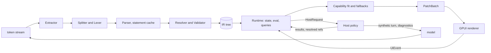

# Implementation Spec: A Streamed, Validated, Native Generative-UI System in Rust

Status: draft 0.1 (phase 1). Working name: `<name>`. Crate names below use `<name>-core`, `<name>-gpui`, and so on. Normative words (MUST, SHOULD, MAY) follow RFC 2119.

Clean-room statement: this document was written from two prior-art study reports only (Appendix A). The syntax, keywords, diagnostic codes, library schema, prompt layout, and message formats here are original to this project.

---

## 0. Goals, non-goals, glossary

### 0.1 Goals

1. A language model emits a compact UI description. It is streamed, parsed, validated, and rendered natively, with a valid UI on screen after every chunk.
2. The core has zero UI dependencies. A renderer is a plug-in that consumes a patch stream.
3. Model output is untrusted. Nothing the model writes can execute arbitrary code, loop forever, exhaust memory without bound, or reach a tool without host approval.
4. Failures degrade locally. The smallest broken unit is dropped, everything else renders, and the drop is reported in a structured form the model can use to correct itself.
5. The final result of a streamed parse MUST equal the result of parsing the whole text at once.
6. Token-cheap output: short names, positional required arguments, no repeated boilerplate, data by reference.
7. Deterministic, testable behavior, with a conformance suite owned by this project from the first commit.

### 0.2 Non-goals (phase 1)

- Renderers other than GPUI. The renderer trait is designed to allow ratatui, egui, and web later. Only GPUI is specified concretely.
- Executing model-authored code of any kind (no JavaScript, no WASM, no user-defined functions).
- Model-supplied styling (raw colors, pixel sizes, CSS-like properties). Only design tokens.
- A hosted service, accounts, persistence backends, or a chat UI. The system is a library plus a sample host.
- Mobile and accessibility-bridge delivery beyond emitting semantic roles (see 5.4). The IR carries what a bridge needs; wiring it to the OS is later work.
- Compatibility with any existing DSL. Prior art informed ideas only.

### 0.3 Glossary

| Term | Meaning |
| --- | --- |
| Program | The model's text in the DSL: a header plus statements. |
| Statement | One logical line (or bracketed group of lines) of the form `name := expression`, or a query, mutate, or remove statement. |
| Library | The set of components, enums, functions, actions, and validators a target offers. Defined in Rust, exported as a Library Spec. |
| IR | Intermediate representation: a validated, typed tree with stable node IDs and semantic roles. |
| Node | One element of the IR tree. |
| Patch | An operation that edits the renderer's retained tree. Patches are grouped in batches. |
| Host | The application around the system. It talks to the model, owns tools and data, and applies policy. |
| Renderer | An implementation of the renderer trait for one UI toolkit. |
| Capability | A named feature a renderer can or cannot provide (charts, images, and so on). |
| Fallback | A declared substitute for a component the renderer cannot draw. |
| Data ref | An opaque ID the model writes that the host resolves into real data. |
| Tail | The unfinished final statement in the streamed text. |
| Sealed | A statement or node whose text is complete and will never change. |
| Fuel | A step budget for expression evaluation. |
| Edit mode | A reply that contains only changed statements, merged by name into an existing program. |

---

## 1. Architecture and crate layout

### 1.1 Layers

```
 LLM token stream (bytes)
        |
        v
 +------------------+   Layer A: syntax
 |  Extractor       |   prose vs. program segments, header
 |  Splitter + Lexer|   one boundary routine, used by stream, batch, merge
 |  Parser          |   statements -> AST (completed statements cached forever)
 +--------+---------+
          v
 +------------------+   Layer B: validation / IR build
 |  Resolver        |   forward refs, cycles, reachability, expansion budget
 |  Validator       |   library schema: args, types, slots, recovery ladder
 |  IR builder      |   typed tree, stable NodeIds, roles, dirty tracking
 +--------+---------+
          v
 +------------------+   Layer C: runtime
 |  State store     |   typed slots, forms, validators
 |  Evaluator       |   fuel-limited expressions, each(), dependencies
 |  Query/Mutation  |   lifecycle, host requests, policy
 |  Action planner  |   inert plans, gesture provenance
 |  Ref resolution  |   host-resolved data by reference
 |  Capability fit  |   fallbacks applied before patches are emitted
 +--------+---------+
          |  PatchBatch stream (insert / set-props / append-text / remove / move)
          v
 +------------------+   Layer D: renderer trait
 |  Renderer        |   GPUI first
 +--------+---------+
          |  UiEvent (input, action requests)
          v
        Host  <---->  model (synthetic user turn, diagnostics feedback)
```



### 1.2 Crates

| Crate | Depends on | Purpose |
| --- | --- | --- |
| `<name>-core` | serde, smallvec, indexmap, thiserror, xxhash | Layers A, B, C (as modules `syntax`, `ir`, `runtime`, `patch`, `diag`, `limits`). No UI, no async runtime, no I/O. `no_std`-friendly goal, not a requirement. |
| `<name>-schema` | serde, serde_json | Library model types: `Library`, `ComponentDef`, `TypeExpr`, Library Spec JSON, JSON Schema export. Used by core and tools. |
| `<name>-derive` | syn, quote | Proc macros `#[derive(Component)]`, `#[derive(UiEnum)]`, `#[ui_function]`, `#[ui_action]`. |
| `<name>-std` | `-schema`, `-derive` | The standard component library definitions. Data only, no drawing code. |
| `<name>-prompt` | `-schema` | Deterministic system-prompt generator and message-protocol helpers. |
| `<name>-gpui` | `-core`, `-std`, `gpui-pre` (exact), `gpui-kit` (exact) | The GPUI renderer. |
| `<name>-conformance` | `-core`, `-prompt` | Fixture runner, fuzz targets, stream-chunking harness. |
| `<name>-cli` | all non-UI crates | `lint`, `parse`, `replay`, `prompt`, `spec`, `fixtures`. |

Rules:

- `-core` MUST NOT depend on any UI crate, on `tokio`, or on `serde_json::Value` as its internal value type. Async work is expressed as requests the host fulfils (7.5).
- The runtime is driven synchronously by `push`/`finish`/`deliver`/`event` calls. The host chooses the executor.
- Component implementations live in renderer crates; component definitions (names, props, roles, fallbacks) live in `-std`. A library with no renderer is valid for parsing, linting, and prompt generation.

### 1.3 Data flow, token to frame

1. The host feeds each model chunk to `Session::push(bytes)`.
2. The extractor finds the program (2.9). Prose segments are passed through as markdown segments.
3. The splitter finalizes complete statements. Each completed statement is parsed once and cached. The open tail is closed implicitly and reparsed (3.3).
4. Dirty statements go to the resolver and validator. Only changed statements and their transitive dependents are re-materialized into IR (3.6).
5. The runtime evaluates dynamic props of dirty nodes, applies capability fallbacks, and diffs against the previously emitted resolved tree.
6. `push` returns an `Update { patches, diagnostics, requests }`. The host forwards `patches` to the renderer.
7. The GPUI renderer applies the batch to its retained tree and calls `notify` on the entities that changed. GPUI paints at the next frame.
8. User input becomes `UiEvent`s sent to the runtime. State writes stay local. Anything leaving the process becomes a host request or a model event (7.6, 7.7).

---

## 2. The language

The language has no name yet. In this document it is called "the DSL". The conventional file extension for fixtures is `.ui`.

### 2.1 Design summary

- Line-oriented. A statement is final as soon as its terminating newline arrives (with a deterministic exception for open brackets, 2.4).
- Forward references are legal. `root` is the entry.
- Required arguments are positional. Optional arguments are named (`name: value`). A required argument MAY also be passed by name.
- Components start with a capital letter. Bindings, functions, and keywords are lower_snake. State is `$name`. Actions are `!name(...)`.
- Strict operators with no implicit coercion. Strings cannot contain raw newlines.
- The first line is a version header.

### 2.2 Lexical rules

Source is UTF-8. Invalid UTF-8 bytes are replaced by U+FFFD before lexing (diagnostic `syntax.bad_utf8`, once per program). CR LF and lone CR are normalized to LF. A tab counts as one column.

| Token | Rule |
| --- | --- |
| `NL` | LF. |
| comment | `--` to end of line, outside strings. Discarded. A line with only a comment is blank. |
| `IDENT` | `[a-z_][a-z0-9_]*`. Max 48 bytes. |
| `COMP` | `[A-Z][A-Za-z0-9]*`. Max 48 bytes. |
| `STATE` | `$` followed by an `IDENT` body. |
| `ACTION` | `!` immediately followed by `IDENT`. |
| `INT` | `[0-9][0-9_]*`, must fit i64. |
| `FLOAT` | `[0-9][0-9_]*\.[0-9]+([eE][+-]?[0-9]+)?` or `[0-9][0-9_]*[eE][+-]?[0-9]+`. Must be finite. |
| `DURATION` | `INT` followed immediately by `ms`, `s`, `m`, or `h`. Valid only where a Duration is expected. |
| `STRING` | `"` ... `"`. Escapes: `\"`, `\\`, `\n`, `\t`, `\r`, `\u{HEX1-6}`. A raw LF ends the string early (see below). |
| punctuation | `( ) [ ] { } , : . ; |` |
| operators | `:=`, `==`, `!=`, `<`, `<=`, `>`, `>=`, `+`, `-`, `*`, `/`, `%`, `++`, `.` |
| keywords | `true false null and or not query mutate remove tool` |
| header line | A line whose first two bytes at column 0 are `%u` and that matches `%ui` (2.8). |

Rules:

- A unary minus is always an operator token, never part of a number literal. `[1 - 2]` and `[1, -2]` are unambiguous because list elements require commas (2.5).
- The lexer never fails. An unknown byte produces `syntax.bad_token` (warning) and is skipped.
- An unterminated string ends at the raw LF, with diagnostic `syntax.unterminated_string`. The string value is what was read. This is deterministic and requires no lookahead.
- Unknown escape `\x`: the backslash is dropped and `x` is kept, with `syntax.bad_escape` (warning).
- `COMP` in call position is a component. A lowercase `IDENT` followed by `(` is a function call. A lowercase `IDENT` not followed by `(` is a reference to a statement name.
- Reserved statement names: `root`, `fallback`, and all keywords. Names starting with `__` are reserved for the system.

### 2.3 Statements

```
statement := bind | state | query | mutate | remove
```

| Form | Meaning |
| --- | --- |
| `name := expr` | Binds `name` to a node expression, a value expression, or an action expression. Its kind is inferred (`Node`, `Value`, `Action`) from the expression's type. |
| `$name := expr` | Declares state with a default. The default MUST be a constant expression (literals, lists, maps; no references). State type is inferred from it (7.2). |
| `query name := tool("tool.id", args, default: v, every: 30s)` | Declares a read-style data source (7.4). |
| `mutate name := tool("tool.id", args)` | Declares a write-style operation. Runs only when an action runs it. |
| `remove a, b` | Valid only in patch mode (9.5). Deletes statements. |

Special statement `fallback := "markdown string"` is optional. If present, it is the model-authored plain-text fallback for the whole message (4.7).

Duplicate names: the first definition wins. Later definitions of the same name are dropped with `name.duplicate` (error). This makes a completed statement permanently stable, which the streaming invariants rely on. Replacement is only possible through edit mode (9.5).

### 2.4 Statement boundaries

This routine is the single splitter used by the stream parser, the batch parser, and the edit merger. Implementations MUST NOT contain a second one.

A statement starts at a line whose first non-space token begins a statement. It ends at the first LF where all of these hold:

1. Bracket depth is zero (`(`, `[`, `{` count; a closer with depth zero is ignored with `syntax.stray_closer`).
2. The last token on the line is not a binary operator, `,`, `:`, or `:=`.
3. Not inside a string (strings end at LF anyway).

Statements MAY span lines only inside brackets or after a trailing operator.

Resync rule. While bracket depth is above zero, a line that starts at column 0 and matches the statement-start pattern `(\$?[a-z_][a-z0-9_]*\s*:=)|((query|mutate|remove)\s)` terminates the open statement. The open statement is auto-closed with `syntax.unclosed_bracket` and a new statement begins at that line. Models are told to indent continuation lines (9.1). The pattern is decidable from the first few bytes of the next line, so no unbounded lookahead exists.

A statement that exceeds `max_stmt_bytes` (16 KiB) is cut at that size with `limit.stmt_size`, closed implicitly, and the rest of its lines are skipped until the next statement start.

Blank lines and comment-only lines are ignored.

### 2.5 Formal grammar (EBNF)

Whitespace and comments between tokens are insignificant except where 2.4 applies. `{ x }` means zero or more, `[ x ]` optional, `|` alternative.

```ebnf
program     = header , NL , { line } ;
line        = NL | statement , NL ;
header      = "%ui" , INT , { attr } ;                 (* see 2.8 *)
attr        = IDENT , "=" , ( IDENT | STRING | INT | version ) ;

statement   = bind | state | query | mutate | remove ;
bind        = IDENT , ":=" , expr ;
state       = STATE , ":=" , expr ;
query       = "query" , IDENT , ":=" , toolcall ;
mutate      = "mutate" , IDENT , ":=" , toolcall ;
remove      = "remove" , IDENT , { "," , IDENT } ;
toolcall    = "tool" , "(" , STRING , "," , expr , { "," , named } , [ "," ] , ")" ;

expr        = or_expr ;
or_expr     = and_expr , { "or" , and_expr } ;
and_expr    = not_expr , { "and" , not_expr } ;
not_expr    = "not" , not_expr | cmp_expr ;
cmp_expr    = cat_expr , [ ( "==" | "!=" | "<" | "<=" | ">" | ">=" ) , cat_expr ] ;
cat_expr    = add_expr , { "++" , add_expr } ;
add_expr    = mul_expr , { ( "+" | "-" ) , mul_expr } ;
mul_expr    = unary , { ( "*" | "/" | "%" ) , unary } ;
unary       = "-" , unary | postfix ;
postfix     = primary , { "." , IDENT | "[" , expr , "]" } ;
primary     = INT | FLOAT | DURATION | STRING | "true" | "false" | "null"
            | list | map | call | action | lambda_use | STATE | IDENT
            | "(" , expr , ")" ;

list        = "[" , [ expr , { "," , expr } , [ "," ] ] , "]" ;
map         = "{" , [ pair , { "," , pair } , [ "," ] ] , "}" ;
pair        = ( IDENT | STRING ) , ":" , expr ;

call        = ( COMP | IDENT ) , "(" , [ args ] , ")" ;
args        = arg , { "," , arg } , [ "," ] ;
arg         = positional | named ;
positional  = expr | lambda ;
named       = IDENT , ":" , ( expr | lambda ) ;
action      = ACTION , "(" , [ args ] , ")" ;
lambda      = "|" , IDENT , [ "," , IDENT ] , "|" , expr ;
lambda_use  = lambda ;       (* legal only as an argument of a higher-order builtin, 2.7 *)
```

Constraints enforced after parsing, not by the grammar:

- In a call, all positional arguments precede all named arguments (`schema.positional_after_named`).
- A lambda body cannot contain another lambda (one level of nesting is enough for `each` inside `each` via a statement reference).
- `args` for components follow the library signature (4.3).
- Max expression depth is 48, enforced by the parser (`limit.expr_depth`).

Parse notes for implementers: `a.b(` is not a call; method calls do not exist. `-` followed by a number is `unary` over a literal; constant folding happens in the validator. `not` binds looser than comparison, so `not a == b` means `not (a == b)`.

### 2.6 Expressions and value semantics

Values: `Null`, `Bool`, `Int(i64)`, `Float(f64)`, `Str`, `Duration`, `List`, `Map` (string keys, insertion ordered), `Ref` (opaque data reference), `Node` (a node instance), `Action` (an inert action plan).

Rust-native numeric rules:

- `Int` arithmetic is checked. Overflow yields an error value, reported as `expr.overflow`, and the containing prop degrades (4.4). `Int / Int` is truncating division. `Int % Int` is the Rust remainder. Division or remainder by zero is `expr.div_zero`, never 0.
- `Float` follows IEEE 754 binary64. Any operation that would produce NaN or an infinity yields `expr.non_finite` instead. NaN and infinities never exist as values.
- `Int op Float` promotes the `Int` to `Float`. Comparisons between `Int` and `Float` compare exactly, not via lossy conversion.
- No string-to-number coercion. `"3" + 1` is `expr.type`.
- `+ - * / %` accept numbers (and `Duration + Duration`, `Duration * Int`). `++` accepts only strings. Use `fmt` or `text_of` to convert.
- `==` and `!=` compare same-type values structurally. `Int` and `Float` compare numerically. Different types are never equal (no coercion, no error). Lists and maps compare structurally.
- `<` `<=` `>` `>=` accept two numbers or two strings (Unicode code-point order). Anything else is `expr.type`.
- `and`, `or`, `not` require `Bool` operands (`expr.type` otherwise). `and`/`or` short-circuit.
- Member access `.f` reads a map key. Missing key yields `Null`. On `Null` it yields `Null`. On any other type it is `expr.type`. Index `[i]` accepts `Int` on lists (out of range is `expr.index_oob`) and `Str` on maps. There is no implicit "pluck over a list"; use `pluck`.
- Number to text: `Int` in decimal. `Float` as the shortest decimal string that round-trips, using the Rust `Display` rules for f64 with no exponent for magnitudes in `1e-5 ..= 1e16` and scientific form outside. `fixed(x, n)` rounds half to even.

An expression that errors evaluates to `Null` plus a diagnostic. The consumer decides (a required prop with `Null` drops the node; an optional prop is omitted).

### 2.7 Built-in functions

All are pure, total, and fuel-metered. Names are lowercase and reserved. Library extensions MAY add functions with the `#[ui_function]` macro (8.5) but MUST NOT shadow built-ins.

| Group | Functions |
| --- | --- |
| Logic | `if(cond, then, else)` (lazy in both branches), `coalesce(a, b, ...)` (first non-null) |
| Lists | `len`, `first`, `last`, `slice(list, start, end)`, `concat(a, b)`, `reverse`, `range(n)` (n <= 1000), `distinct` |
| Aggregation | `count`, `sum`, `avg`, `min`, `max` over a list of numbers, or `field`-addressed: `sum(rows, "amount")`. A field path is a dot-separated string. |
| Higher-order | `map(list, \|x\| expr)`, `filter(list, \|x\| bool_expr)`, `sort_by(list, \|x\| key, "asc"\|"desc")`, `each(list, \|x, i\| node_expr, key: \|x\| key_expr)`, `pluck(list, "path")` |
| Numbers | `round`, `floor`, `ceil`, `abs`, `clamp(x, lo, hi)`, `fixed(x, decimals)`, `pct(x, decimals)` |
| Text | `fmt(template, args...)` where the template uses `{}` placeholders and `{{`/`}}` escapes, `upper`, `lower`, `trim`, `contains`, `starts_with`, `ends_with`, `join(list, sep)`, `split(s, sep)`, `text_of(v)` (any scalar to text) |
| Time | `now_ms()` is NOT provided (it would make renders non-reproducible). A host MAY provide `host_now()` as a library function, evaluated lazily and flagged volatile. |

Semantics notes:

- `sort_by` is stable. The key must be number or string within one call (mixed types: `expr.type`). Strings sort by Unicode code point. This is the only collation in the core; locale-aware sorting is a renderer or library concern and not part of the language.
- Lambdas are not values. They exist only as an argument of `map`, `filter`, `sort_by`, `each`, and the `key:` argument of `each`. A lambda binds its parameter names, which shadow statement names. Free references inside a lambda resolve to statements and state as usual.
- `each` is the only iteration construct that yields nodes. It is lazy: the template is evaluated once per element, bounded by `each_max_items` (2000), and the result is a list of node instances (2.10).
- `range` and all list-producing functions count toward the evaluation fuel and a per-call element cap of `max_list_len` (10,000).

### 2.8 Version header

The first non-blank line MUST be:

```
%ui <major> [lib=<id>@<semver>] [mode=full|patch] [dir=ltr|rtl]
```

- `major` is the language major version (phase 1: `1`). A parser supports exactly the majors it lists. An unsupported major is `syntax.header_version` (fatal): nothing is rendered, the fallback text is used if available.
- `lib` names the library the model targeted. A mismatch with the active library is `lib.mismatch` (warning). A different major of the same library id is an error: the validator still proceeds, using the active library's definitions.
- `mode=patch` selects edit mode (9.5). Default is `full`.
- Unknown attributes are ignored with an info diagnostic. Attribute order is free.
- A missing header is `syntax.header_missing` (warning). The parser assumes major 1, `full` mode, and treats the first line as a statement. This keeps older or sloppy output usable but costs a diagnostic.
- Until the header's LF arrives, no statement is processed. The header is one of the first things an incremental parser can finalize.
- A second header line later in the program is `syntax.header_repeat` (warning) and ignored.

Language minor evolution: new syntax within a major MUST be gated by a header attribute (for example `ext=...`) or be a strict superset that old parsers treat as an existing error class. Existing programs MUST keep their meaning within a major.

### 2.9 Extraction from model output

Models often add prose. The extractor runs before the lexer and is a small state machine:

1. In `Prose` state, text is accumulated as a markdown segment. A line that begins at column 0 with `%ui` switches to `Program` state at that line. A fence line ```` ```ui ```` (language tag `ui`) switches to `Program` state at the next line. Anything else stays prose.
2. In `Program` state, bytes feed the lexer. A closing fence (```` ``` ```` at column 0) ends the program and returns to `Prose` state. For an unfenced program, the program ends at end of stream.
3. A message MAY contain several program segments. The stored/rendered program is the last complete one (a segment is complete if its closing fence or the end of stream was seen). Earlier ones are kept as history.
4. Strings never end a fence; the fence check is line-based at column 0 only.

The extractor's output is an ordered list of `Segment::Markdown(String)` and `Segment::Program(ProgramId)`.

### 2.10 Reference instantiation

A name used as a child in several places creates one node instance per use (a tree, never a shared DAG node). Instances share state and queries, not node identity (5.2). Expansion is budgeted: the total instantiated node count is bounded by `max_expanded_nodes` (10,000). When the budget is exceeded the instantiation stops, the affected slot is truncated, and `limit.expansion` (error) is reported once per statement.

### 2.11 Components, arguments, and slots

```
Button("Save", tone: "primary", on_click: !run(save))
Table([Column("Title", "title"), Column("Age", "age_days", align: "end")], rows: tickets)
Vert([header, body], gap: 3)
```

- Required arguments are positional, in the order the library declares them. Optional arguments are named only.
- A required argument MAY be passed by name instead (`Button(label: "Save")`). Positional arguments then fill the remaining required parameters in order. This is tolerance for model slips, and it is logged as `schema.required_by_name` (info).
- A named argument may appear once. Repetition is `schema.dup_arg` (warning); the first wins.
- Child content is an ordinary list-typed required or optional argument (a "slot"): `Vert([a, b])`. Slots accept node expressions, references to node statements, or `each(...)`.
- Why this shape: adding an optional prop to a component never changes the meaning of existing programs. Adding a required prop or reordering required props is a breaking library change (8.7).

### 2.12 State

```
$tab := "overview"
$qty := 1
```

- Declaration `$x := const_expr`. Reading `$x` anywhere yields the current value. An undeclared `$x` is `state.undeclared` (error) and reads as `Null`; it is never auto-declared.
- A bindable prop (a `Binding<T>` parameter, written `bind: $x`) displays the state and writes user edits back. Elsewhere `$x` is a value read.
- Actions write state: `!set($x, expr)`, `!reset($x, $y)`.
- State is typed by its default (7.2). A write of a different type is `state.type_write` and is ignored.
- State is scoped to one program instance. Re-parsing or edit-mode merges never delete user-written values; see 7.2 for the origin rules.

### 2.13 Forms

```
form := Form([name_f, email_f, go], on_submit: !say("Create the account"))
name_f := TextField("Name", bind: $name, rules: [required(), max_len(60)])
email_f := TextField("Email", bind: $email, rules: [required(), email()], kind: "email")
go := Button("Create", tone: "primary", submit: true)
```

- Fields belong to the nearest enclosing `Form`. Fields outside any form belong to the page scope.
- `rules` is a list of validator calls. Validators are a closed set registered in the library (`required`, `email`, `url`, `number`, `min_len(n)`, `max_len(n)`, `min(n)`, `max(n)`, `one_of(list)`, `named("slug")`). No regular expressions come from the model. A library MAY register further named validators implemented in Rust.
- A button with `submit: true`, or any action flagged `needs_valid_form`, is gated in the core (7.3): the action does not fire until every field in the enclosing form validates. Renderers display errors but do not decide.
- Fields with `sensitive: true` (password, secret) are never included in events returned to the model (7.7).

### 2.14 Queries, mutations, actions

```
query tickets := tool("tickets.list", {status: $status}, default: [], every: 60s)
mutate close := tool("tickets.close", {id: $selected})
done := Button("Close ticket", on_click: !seq(!run(close), !run(tickets)))
```

- The tool name is an opaque string the host maps to a real tool. Arguments are a map expression; they are evaluated when the request is built.
- `default:` is the value shown until a result arrives (and while the stream is not finished). `every:` is a refresh interval, minimum 5s.
- Query statements and mutation statements are statement-level forms only. A bare `tool(...)` anywhere else is `syntax.stmt_shape`.
- A query depends on every `$state` read literally in its args; a change re-runs it (debounced 250 ms).

Built-in actions (inert data until a user gesture):

| Action | Effect |
| --- | --- |
| `!set($x, expr)` | Write state. |
| `!reset($a, $b)` | Restore declared defaults. |
| `!run(name)` | Run a mutation, or refetch a query. |
| `!say(message, ctx)` | Ask the host to send a new user turn to the model (7.7). `ctx` is an optional map. |
| `!open(url)` | Ask the host to open a URL, subject to URL policy. |
| `!emit("event_name", {params})` | Deliver a library-declared custom event to the host. |
| `!seq(a, b, ...)` | Sequence. A bare list `[a, b]` in an action slot is the same. |

Actions are never executed by the parser or evaluator. They produce a plan (7.3). `!set`, `!reset`, `!run` take their targets by name and do not evaluate them.

### 2.15 Examples

Dashboard with a chart, a table, and a filter:

```
%ui 1 lib=std@0.1
root := Vert([top, filters, summary, grid], gap: 3)
$range := "30d"
top := Heading("Sales", level: 1)
filters := Horiz([Choice("Range", ["7d", "30d", "90d"], bind: $range), Button("Refresh", on_click: !run(sales))], gap: 2)
query sales := tool("sales.by_month", {range: $range}, default: [], every: 120s)
summary := Panel([Para(fmt("Total: {}", fixed(sum(sales, "revenue"), 2)))], title: "Summary")
grid := Tiles([chart, tbl], cols: 2)
chart := Chart("bar", data: sales, x: "month", y: ["revenue"], title: "Revenue by month", summary: "Revenue rises through spring.")
tbl := DataTable([Column("Month", "month"), Column("Revenue", "revenue", align: "end")], rows: sales)
fallback := "## Sales\nRevenue by month for the selected range."
```

Data by reference:

```
%ui 1 lib=std@0.1
root := Vert([Heading("Nearby ramen", level: 2), list])
list := Items(each(ref("t4.places"), |p| Horiz([Picture(p.photo, alt: p.name), Para(p.name)]), key: |p| p.id))
```

Here `ref("t4.places")` is resolved by the host into a list of maps; the model never writes the photo URLs or names (7.5).

Form with a synthetic-turn action:

```
%ui 1 lib=std@0.1 
root := Panel([Para("Pick a laptop"), budget, use, go], title: "Laptop finder")
$budget := "mid"
$use := []
budget := Radios("Budget", ["low", "mid", "high"], bind: $budget, rules: [required()])
use := Checks("Use", ["coding", "gaming", "travel"], bind: $use)
go := Button("Find laptops", submit: true, on_click: !say("Recommend laptops", {budget: $budget, use: $use}))
```

Edit-mode reply to the dashboard (changes only the title and drops the table):

```
%ui 1 lib=std@0.1 mode=patch
top := Heading("Revenue", level: 1)
grid := Tiles([chart], cols: 1)
remove tbl
```

---

## 3. Streaming parser

### 3.1 Inputs and API shape

The parser is a push parser: `push(&mut self, chunk: &[u8]) -> Update` and `finish(&mut self) -> Update`. Chunks may split UTF-8 sequences, tokens, escapes, and lines anywhere. The parser buffers an incomplete UTF-8 suffix (at most 3 bytes).

### 3.2 State

- `completed: Vec<Stmt>` — sealed statements in text order. Each holds its AST, span, and a content hash. Never mutated after sealing.
- `tail: String` — bytes of the open statement.
- `scan: ScanState` — bracket stack, string flag, last significant token class, column, line. The scanner resumes at the previous byte offset; it never rescans completed text.
- `header: Option<Header>`.
- `symbols: IndexMap<Name, StmtId>` plus a reverse dependency map.

### 3.3 Chunk handling and tail closing

For each chunk:

1. Append to the buffer; advance `scan` from the watermark.
2. Each time the splitter finalizes a statement (2.4), parse it once, seal it, and clear that part of the tail.
3. If an unsealed tail remains, build a closed copy and parse it as a provisional statement. Closing rules, applied in this order:
   1. If the tail ends inside a string, close it. If it ends with an unpaired backslash, drop the backslash first. If it ends inside `\u{...}` that is incomplete, drop the partial escape.
   2. If the last token is an `IDENT` or `COMP` touching the end of the buffer, treat it as growing: remove it (it may be the prefix of a longer name). A trailing `INT`/`FLOAT` is kept, marked partial.
   3. Remove a dangling operator, `,`, `:`, or `:=` together with any incomplete named-argument name left before it.
   4. Close open brackets in reverse order.
   5. If the statement still fails to parse, produce no provisional statement.
4. A provisional statement is flagged `partial`. Its node is emitted with `status: Partial`. It never replaces anything: names are claimed only by sealed statements, so a provisional statement for a name already sealed is discarded.
5. The provisional result is used only for display. It generates no queries, no mutations, no state declarations, and no non-provisional diagnostics.

`finish()` seals the tail as if the stream ended at a newline. The tail then goes through the same parse as in batch, including real diagnostics (`syntax.unclosed_bracket`, and so on).

### 3.4 Late-arriving context

Because completed statements are immutable and the first definition of a name wins, a later chunk cannot change an earlier statement's meaning. The only cross-statement effects are:

- A forward reference resolved by a later statement (the placeholder becomes a node).
- The extractor discovering a fence after prose. This is not a prefix rewrite: the program begins at the fence line, and earlier text is already prose.

The "cache invalidation by changed prefix" concern of line-oriented designs does not apply. If the host replaces the text (regenerate), it MUST call `reset()`, which starts a new epoch (6.5).

### 3.5 Invariants

I1. Sealed statements never change after sealing.
I2. After `finish()`, the IR, the resolved tree, and the non-provisional diagnostics equal those of `parse_batch(full_text)`. This is mechanically tested by the conformance runner for every fixture under many chunkings (12.3).
I3. Chunking independence: the final result does not depend on chunk boundaries.
I4. Monotonic sealing: the set of sealed statements only grows, in text order.
I5. A valid tree exists after every chunk once `root` is defined. Before that, the renderer shows an empty or placeholder state.
I6. No query or mutation request is created, no state is declared, and no action can fire from provisional content. Dispatching actions is additionally disabled until `finish()` (7.3).
I7. Any single chunk is processed in bounded time (3.8).

### 3.6 Incremental IR maintenance

- Sealing statement S marks S dirty. Dirty propagates to statements that reference S (reverse deps) and to the nodes instantiated from them.
- Re-materialization is limited to the dirty set. Node instances for unaffected statements keep their NodeIds and are not touched.
- A placeholder (unresolved forward reference) records the awaited name. When a statement defining that name is sealed, the awaiting slot is re-materialized and an `Insert` patch results.
- Provisional output is computed from the tail only and diffed against the previous provisional output of the same statement.

### 3.7 Streaming-time diagnostics

Some diagnostics depend on later text. While streaming they are held back as `provisional: true` and re-checked at `finish()`:

- `name.unresolved`, `name.no_root`, and `schema.missing_required` when the missing value is caused by an unresolved reference.
- Enum and range checks on partially received values.
- Orphan reporting.

Provisional diagnostics MAY be shown in developer UI but MUST NOT be fed back to the model (4.6).

### 3.8 Complexity and performance targets

Let `c` be the chunk size, `t` the tail length (bounded by 16 KiB), `d` the dirty set size.

| Operation | Target |
| --- | --- |
| Scan per chunk | O(c) |
| Tail reparse per chunk | O(t) |
| Sealed statement parse | O(statement) once |
| IR update | O(d) nodes, not O(program) |
| Patch generation | O(changed props) |

Concrete budgets on a 2023 Apple-silicon laptop, release build: a 64-byte chunk on a 1,000-node program processes in under 150 microseconds at p99. Batch parse of a 200 KB program in under 15 ms. Peak memory under 4 MB for a 5,000-node program. These are CI-benchmarked (criterion) with regressions over 20 percent failing.

---

## 4. Validation and recovery

### 4.1 Principles

1. Drop the smallest broken unit; render the rest.
2. Every recovery is deterministic and depends only on sealed text and the library.
3. Every recovery emits a structured diagnostic.
4. Nothing the model writes may panic, hang, or exceed limits. Parser and validator are `#![forbid(unsafe_code)]` and fuzzed.

### 4.2 Diagnostic structure

```rust
pub struct Diagnostic {
    pub code: Code,               // enum, stable string form like "schema.type_mismatch"
    pub severity: Severity,       // Info | Warning | Error | Fatal
    pub phase: Phase,             // Syntax | Resolve | Schema | Expr | Runtime | Host | Render
    pub stmt: Option<String>,     // statement name
    pub node: Option<NodeId>,
    pub span: Option<Span>,       // byte range, line, column
    pub path: Option<String>,     // "args[1]", "gap", "children[2]"
    pub expected: Option<String>, // short type text
    pub found: Option<String>,
    pub action: Recovery,         // what the system did
    pub hint: Option<String>,     // signature line or candidate names
    pub provisional: bool,
}
pub enum Recovery { Skipped, Defaulted, ArgOmitted, NodeDropped, StatementDropped, SlotTruncated, ValueNulled, Kept, ProgramRejected }
```

### 4.3 Diagnostic codes

Codes are dotted names, stable across versions once released.

| Code | Sev | Recovery |
| --- | --- | --- |
| `syntax.bad_utf8` | Warning | Replacement char used. |
| `syntax.bad_token` | Warning | Byte skipped. |
| `syntax.bad_escape` | Warning | Backslash dropped. |
| `syntax.unterminated_string` | Warning | String ends at line end. |
| `syntax.unclosed_bracket` | Error | Statement auto-closed, then validated. |
| `syntax.stray_closer` | Warning | Ignored. |
| `syntax.missing_comma` | Warning | Comma inserted when the next token starts an expression. |
| `syntax.stmt_shape` | Error | Statement dropped (line is not a recognized statement form). |
| `syntax.header_missing` / `syntax.header_repeat` | Warning | Assume defaults / ignore. |
| `syntax.header_version` | Fatal | Program rejected. |
| `lib.mismatch` | Warning | Continue with active library. |
| `name.duplicate` | Error | Later statement dropped. |
| `name.reserved` | Error | Statement dropped. |
| `name.unresolved` | Warning | Reference omitted from slot, `Null` in expressions. |
| `name.cycle` | Error | The closing edge is dropped. |
| `name.no_root` | Fatal | No tree; fallback text used. |
| `name.orphan` | Info | Statement not rendered. |
| `schema.unknown_component` | Error | Node dropped. In a slot, removed. |
| `schema.unknown_prop` | Warning | Argument omitted. |
| `schema.missing_required` | Error | Library default if declared, else node dropped. |
| `schema.arity_extra` | Warning | Extra positional args dropped. |
| `schema.dup_arg` | Warning | First wins. |
| `schema.positional_after_named` | Warning | Argument kept at its parsed position; if ambiguous, dropped. |
| `schema.required_by_name` | Info | Accepted. |
| `schema.type_mismatch` | Error | Default if declared; else optional arg omitted, required arg drops the node. |
| `schema.bad_enum` | Error | As type mismatch; hint lists legal values. |
| `schema.out_of_range` | Warning | Clamped when the library marks the prop clampable, else as type mismatch. |
| `schema.slot_kind` | Error | Wrong child kind (data in a node slot, node in a data prop): element dropped. |
| `schema.bind_target` | Error | `bind:` not a state variable, or the type is wrong: binding dropped, static value shown. |
| `schema.cap_missing` | Info | Fallback applied (see 8.6). |
| `expr.unknown_fn` | Error | Evaluates to `Null`. |
| `expr.type` / `expr.overflow` / `expr.div_zero` / `expr.non_finite` / `expr.index_oob` | Error | Evaluates to `Null`. |
| `expr.lambda_misuse` | Error | Lambda outside a higher-order builtin: expression is `Null`. |
| `state.undeclared` | Error | Reads as `Null`. |
| `state.type_write` | Warning | Write ignored. |
| `form.unknown_validator` | Warning | Rule omitted. |
| `tool.unknown` / `tool.denied` | Error | Query keeps default; mutation reports failure. |
| `tool.failed` | Error (runtime) | Last good data kept. Not sent to the model as a correction (4.6). |
| `ref.invalid` | Error | Ref value is `Null`. |
| `ref.unresolved` | Warning | Component shows its pending state. |
| `ref.too_large` | Error | Resolution rejected by host or core limits. |
| `limit.stmt_size` / `limit.stmt_count` / `limit.program_size` | Error | Remaining input ignored. |
| `limit.expr_depth` / `limit.ir_depth` / `limit.nodes` / `limit.expansion` / `limit.fuel` / `limit.list_len` | Error | Subtree or value dropped. |
| `edit.unknown_target` | Warning | `remove` of a missing name: ignored. |
| `edit.root_removed` | Error | Removal of `root` rejected. |
| `render.panic` | Error | Last good props reused or placeholder shown (10.8). |

### 4.4 Recovery ladder

Applied bottom-up. Each step stops the cascade, and a parent only sees the effect of a child's recovery as an absent or defaulted value.

1. Token: skip the byte, insert a missing comma, ignore a stray closer.
2. Value: an expression that errors becomes `Null` (with a diagnostic).
3. Argument: a bad optional argument is omitted. A bad required argument takes its library default if one exists.
4. Node: if a required argument is still missing, the node is dropped.
5. Slot: a dropped child is removed from its parent's slot. The parent renders with the remaining children. If a slot declares `min_items` and is under it, the parent is dropped (step 4 applies to the parent).
6. Statement: a statement that cannot be parsed or classified is dropped.
7. Program: with no `root`, or an unsupported header major, nothing renders; the fallback text is shown.

A node drop MUST NOT cascade farther than the parent's slot unless a declared constraint forces it.

### 4.5 Severity and fatality

`Fatal` is reserved for the two program-level failures. Everything else is recoverable. The host MAY choose to retry generation after a fatal diagnostic.

### 4.6 Model-feedback format

Diagnostics useful for correction are rendered to a compact text block the host can add to the next model request:

```
%diag 1 program=sales
- schema.bad_enum stmt=chart arg=tone found="loud" expected="primary|quiet|danger" -> arg omitted
- name.unresolved stmt=grid ref=summary_card -> omitted
- schema.missing_required stmt=tbl arg=rows hint="DataTable(columns: Column[]; rows, ...)" -> node dropped
```

Rules:

- Only `Error` and `Warning` diagnostics with phase `Syntax`, `Resolve`, `Schema`, or `Expr` appear. `Runtime`, `Host`, and `Render` diagnostics (network failures, denied tools, panics) are excluded: they are not the model's fault.
- Provisional diagnostics are excluded. Feedback is built only after `finish()`.
- At most 20 lines, ordered by severity then text order. Deduplicate by (code, stmt, arg).
- The block is plain ASCII, one line per diagnostic, keys in a fixed order, so prompts that include it are reproducible.
- The machine form is the serde JSON of `Vec<Diagnostic>`.
- Emission policy: clear on stream start, emit only on change, send an empty list on recovery.

### 4.7 Fallback text

Every message has `fallback_text: String` (CommonMark subset). Sources in order of preference: the model's `fallback := "..."` statement, then text derived from the IR (each component declares a `to_text` template, for example `Heading` yields `## {text}`, `DataTable` yields a pipe table, `Chart` yields its `summary` plus a table), then the plain prose segments of the message. Fallback text is used when: the program is fatal, the renderer lacks every needed capability, the user disables rich UI, or the message is exported or copied.

---

## 5. IR

### 5.1 Node model

```rust
pub struct Node {
    pub id: NodeId,
    pub kind: ComponentId,            // index into the library
    pub role: Role,                   // semantic role (5.4)
    pub props: Props,                 // typed, see 5.5
    pub slots: SmallVec<[Slot; 2]>,   // ordered child lists, named by the library
    pub status: NodeStatus,           // Partial | Sealed
    pub origin: StmtId,               // statement this instance came from
    pub a11y: A11y,                   // label, description, live-region hints
}
pub struct Slot { pub name: SlotName, pub children: Vec<NodeId> }
pub enum NodeStatus { Partial, Sealed }
```

The IR tree is rooted at the `root` statement's value. It is a tree: shared statements are instantiated per use (2.10). Statement bodies that are not nodes (values, actions) live beside the tree in a `ValueTable`.

### 5.2 Stable node IDs

`NodeId` is a 64-bit hash of a *path string*; the path is kept in a side table for debugging and diagnostics. Path construction:

```
root                         the root statement's value
<parent>/<slot>:<key>        a child in a slot
```

where `<key>` is:

- the statement name, if the child was given as a reference (`children:header`);
- the zero-based index within the slot, if the child is an inline component call (`children:1`);
- the `each` key rendered as text, if produced by `each` with a `key:` lambda (`children:row=1042`), or the index (`children:#3`) if no key was given.

Properties:

- IDs depend only on structure and names, not on arrival order or chunking.
- Appending children to a slot does not change existing IDs.
- Reordering references yields `Move` patches, not remove and insert, because keys are names.
- Inline children are position-keyed, so inserting at the front of an inline list renames the siblings. This is acceptable because streaming only appends; edit mode replaces a whole statement and diffs by key.
- Duplicate `each` keys in one slot are `schema.dup_key` (warning) and the later items fall back to index keys.
- Collision of 64-bit hashes is resolved by a table check at insert time. A collision is a `limit.ir_depth`-class internal error: the node is dropped.

Rename stability: if the same component stays at the same path after a statement is redefined (edit mode), the `NodeId` is retained and only a `SetProps` is emitted, so GPUI entities, focus, and scroll offsets survive. If the component kind changes at a path, the node is replaced (`Remove` + `Insert`), but state (stored by state variable, not by node) survives.

### 5.3 Dirty tracking

Each statement carries a revision counter. Each node instance records `(origin, origin_rev, dep_revs)`. Re-materialization compares revisions; unchanged instances are reused.

### 5.4 Semantic roles

Every component declares a `Role` in the library. The IR carries it for accessibility trees and for non-visual renderers (a terminal reader, a screen-reader bridge).

```rust
pub enum Role {
    Generic, Region, Group, Heading(u8), Paragraph, Text, Code, Separator, Image, Figure,
    Link, Button, TextInput, MultiLineInput, Checkbox, RadioGroup, Radio, Switch, Slider, Select,
    Form, List, ListItem, Table, Row, Cell, ColumnHeader,
    TabList, Tab, TabPanel, Progress, Status, Alert, Chart, Disclosure, Dialog,
}
```

Rules:

- Roles are fixed per component (with a small set of value-dependent variants: `Heading(level)`).
- `A11y.label` MUST be supplied for `Image` (the `alt` argument is required in the library), `Chart` (the `summary` argument; if absent, the core synthesizes "chart: N series, M points" and sets `schema.a11y_missing` info), and for any input without a visible label.
- A node's live-region politeness (`Status`, `Alert`) is a property of its role.
- Role plus label plus value is sufficient to produce a flat accessibility tree without knowledge of component internals.

### 5.5 Props typing

```rust
pub enum Value {
    Null, Bool(bool), Int(i64), Float(f64), Str(Arc<str>), Duration(u64 /*ms*/),
    List(Arc<[Value]>), Map(Arc<IndexMap<Arc<str>, Value>>),
    Ref(RefId), Token(TokenValue),         // design token (e.g. space=3)
    Binding(Binding), Action(ActionPlanId), Validator(ValidatorId),
}
pub enum Prop {
    Static(Value),                          // fully known at build time
    Dynamic(ExprId),                        // depends on state, queries, refs
}
pub struct Props(SmallVec<[(PropId, Prop); 6]>);
```

- Props are keyed by `PropId` (a small integer from the library definition), not by string, inside the process. Strings appear only in serialization.
- Every prop has a `TypeExpr` in the library (8.4). The validator checks literals at build time and dynamic values at evaluation time.
- Design tokens (`gap: 3`, `tone: "danger"`) are checked against token scales. The model never supplies raw pixels or colors.

---

## 6. Patch protocol

### 6.1 Purpose

The renderer holds a retained tree. The core sends edits to that tree, keyed by `NodeId`. A renderer never receives the whole tree except as a sequence of inserts after a reset.

### 6.2 Operations

```rust
pub struct PatchBatch { pub epoch: u32, pub seq: u64, pub ops: Vec<Op> }

#[serde(tag = "op", rename_all = "snake_case")]
pub enum Op {
    Reset,                                              // clear tree, start of an epoch
    Insert { parent: Option<NodeId>, slot: SlotName, index: u32, node: NodeInit },
    SetProps { id: NodeId, set: Vec<(PropId, Value)>, unset: Vec<PropId> },
    AppendText { id: NodeId, prop: PropId, text: String },
    Remove { id: NodeId },                              // removes the whole subtree
    Move { id: NodeId, parent: Option<NodeId>, slot: SlotName, index: u32 },
    SetStatus { id: NodeId, status: NodeStatus },        // Partial -> Sealed
    SetMeta { id: NodeId, role: Option<Role>, a11y: Option<A11y> },
}
pub struct NodeInit { pub id: NodeId, pub kind: ComponentId, pub role: Role, pub props: Vec<(PropId, Value)>, pub status: NodeStatus, pub a11y: A11y }
```

`NodeInit` never contains children. Children arrive as their own `Insert` ops.

### 6.3 Guarantees

G1. A batch is atomic: it is applied fully before the next paint. The core emits one batch per processed chunk, per delivered result, or per UI event.
G2. Ops in a batch are applied in order. An `Insert`'s `parent` exists (in the tree or inserted earlier in the batch). `index` is relative to the sibling list as it stands when that op is applied, and `index <= len`.
G3. `Remove` removes the node and all descendants. No op in later batches may mention their IDs unless re-inserted.
G4. `Move` of an ancestor into its own subtree is never emitted.
G5. `AppendText` is emitted only when the new string value extends the old one (same prefix). Otherwise `SetProps` is used.
G6. Replaying all batches of an epoch from `Reset` produces exactly the resolved tree the core holds. The conformance suite checks this (12).
G7. `seq` increases by one per batch within an epoch. A renderer that sees a gap MUST request a resync (the host calls `Session::snapshot()` which returns a `Reset` plus inserts).
G8. `epoch` changes when the host calls `reset()` (regenerate), or when a snapshot is taken. A renderer discards batches from older epochs.
G9. The patch stream carries *resolved* props: expressions are already evaluated; bindings, action-plan IDs, and validators remain as handles the renderer passes back in events.

### 6.4 Coalescing

Within one batch the core coalesces: repeated `SetProps` on the same node merge; `AppendText` runs merge; an `Insert` followed by `Remove` of the same node cancels; ops are ordered parents before children and siblings in index order. The host SHOULD additionally coalesce batches to at most one application per frame (10.6).

### 6.5 Serialization

Batches are `serde` types. The reference wire format is JSON Lines (one batch per line) for tests, logging, and remote renderers. A compact binary format (postcard or CBOR) MAY be used in-process or over a socket. `PropId` serializes as the prop's string name in JSON and as an integer in binary, with the library hash in a stream header so the two sides agree. Example:

```json
{"epoch":1,"seq":7,"ops":[
 {"op":"insert","parent":"n:root","slot":"children","index":1,
  "node":{"id":"n:root/children:filters","kind":"Horiz","role":"group","props":{"gap":2},"status":"partial"}},
 {"op":"append_text","id":"n:root/children:top","prop":"text","text":" quarter"}
]}
```

### 6.6 How renderers apply patches

Pseudocode for the reference algorithm:

```
for op in batch.ops:
  Reset            => tree.clear()
  Insert           => tree.create(node); tree.attach(parent, slot, index, id)
  SetProps         => tree.node(id).props.apply(set, unset); mark dirty
  AppendText       => tree.node(id).text_mut(prop).push_str(text); mark dirty (text-only)
  Remove           => tree.detach(id); tree.drop_subtree(id)
  Move             => tree.detach(id); tree.attach(parent, slot, index, id)
  SetStatus/Meta   => update node, mark dirty
after loop: notify only dirty nodes' views
```

A renderer MUST tolerate ops in G2 order only; it MAY panic-free ignore an op referencing an unknown ID after logging, and request a resync.

---

## 7. Runtime

### 7.1 Evaluation model and limits

The evaluator is a tree-walking interpreter over a validated, compact expression IR (`ExprId`). It has no loops other than the bounded builtins, no recursion between statements (cycles are cut in the resolver), and no side effects.

Each evaluation pass has a fuel meter. One fuel unit is charged per expression node visited, plus per element for list-producing builtins. Running out yields `limit.fuel` and `Null` for the affected prop only.

Default limits (hosts MAY lower them, and MAY raise them within the hard ceilings noted):

| Limit | Default | Hard ceiling |
| --- | --- | --- |
| `max_program_bytes` | 256 KiB | 4 MiB |
| `max_stmt_bytes` | 16 KiB | 64 KiB |
| `max_stmt_count` | 2,000 | 20,000 |
| `max_bracket_depth` | 32 | 64 |
| `max_expr_depth` | 48 | 96 |
| `max_ir_depth` | 24 | 48 |
| `max_nodes` (sealed IR, pre-expansion) | 5,000 | 50,000 |
| `max_expanded_nodes` | 10,000 | 100,000 |
| `fuel_per_pass` | 200,000 | 5,000,000 |
| `fuel_per_prop` | 5,000 | 100,000 |
| `max_list_len` | 10,000 | 100,000 |
| `each_max_items` | 2,000 | 20,000 |
| `max_string_bytes` | 64 KiB | 1 MiB |
| `max_ref_resolutions_per_message` | 64 | 512 |
| `max_resolved_data_bytes` | 5 MiB | 64 MiB |
| `max_state_bytes` | 256 KiB | 4 MiB |

Limits are checked at the earliest point possible (lexer, parser, builder) so adversarial input is rejected cheaply.

### 7.2 State store

```rust
pub struct StateStore { slots: IndexMap<StateKey, Slot> }
pub struct Slot { value: Value, ty: StateType, origin: Origin, default: Value, rev: u64 }
pub enum Origin { Default, User, Action }
```

- Declaring `$x := default` creates a slot with `origin = Default`. `StateType` is inferred from the default: bool, int, float, str, list of T, map, or "nullable T" if the default is `null` and the library binding type tells the type.
- Re-declaration through edit mode updates `default`, and updates `value` only if `origin == Default`.
- Writes by users or actions check type (`state.type_write`) and set `origin` to `User` or `Action`.
- No auto-declaration. `$x` without a declaration is `state.undeclared`.
- Removed declarations (via `remove $x`) delete the slot unless the key is bound by a live node, in which case the slot is kept and flagged orphaned until the node goes away.
- Changes bump `rev`. The evaluator records per-prop dependencies (state keys, query IDs, ref IDs) so only affected props re-evaluate.
- State is plain data, serializable (`serde`) for persistence by the host. Sensitive fields are marked and excluded from model-visible snapshots.

### 7.3 Forms and action planning

Forms are first-class in the runtime, not component hacks:

- Each form-scoped field registers `(form, name, state key, rules, sensitive)` with the runtime.
- `validate(form)` runs the rules in order per field; the first failure is that field's error (`FieldError { code, message_key }`). Empty values skip every rule except `required`. Results are a `FormStatus` the renderer reads through props (`error`, `touched`).
- A field is `touched` on blur or on a submit attempt.

Action planning:

```rust
pub struct ActionPlan { pub steps: Vec<Step>, pub needs_valid_form: Option<FormId>, pub origin_node: NodeId }
pub enum Step { Set(StateKey, Expr), Reset(Vec<StateKey>), Run(TargetId), Say{ msg: Expr, ctx: Expr }, Open(Expr), Emit{ name: String, params: Expr } }
```

Execution on a `UiEvent::Activate { node, handle }`:

1. If the stream is not finished (`phase != Done`), dispatch actions are ignored (state writes via bindings still work on sealed fields).
2. If the plan needs a valid form and `validate(form)` fails, no step runs; all fields become touched.
3. Steps run in order. `Set` and `Reset` apply immediately. `Run` of a query invalidates and refetches (fire and forget). `Run` of a mutation and every host-facing step creates a `HostRequest` (7.4, 7.7) with `Origin::UserGesture { node }`.
4. Arguments of a step are evaluated when the step starts, so earlier `Set` steps are visible. Each step is fuel-metered.
5. A mutation step is awaited. If it fails, the remaining steps are cancelled and a `Runtime` diagnostic is recorded.

### 7.4 Queries and mutations

```rust
pub enum RequestStatus { Idle, Loading, Ready, Refetching, Failed }
pub struct HostRequest { pub id: RequestId, pub kind: ReqKind, pub origin: Origin, pub program: ProgramId }
pub enum ReqKind {
    ToolQuery    { tool: String, args: Value, key: u64 },
    ToolMutation { tool: String, args: Value },
    ResolveRef   { ref_id: RefId, shape: DataShape },
    Say          { message: String, ctx: Value },
    OpenUrl      { url: String },
    Custom       { name: String, params: Value },
}
```

- **Approval.** Core never calls tools. It emits a `HostRequest`, and the host answers `Allow`, `Deny(reason)`, or `AskUser(prompt)` through its `HostPolicy` before executing. The core records the verdict. `Deny` yields `tool.denied` and the default value stays.
- **Queries** are requested after `finish()` (never while streaming), then again when a state dependency changes (debounce 250 ms) or on the refresh timer. The cache key is a stable hash of tool, evaluated args. While refetching, the previous result stays visible and `RequestStatus` is `Refetching`. A late response for a stale key is discarded.
- **Mutations** never run on their own. They require `Origin::UserGesture`. A second run while `Loading` is rejected. Args are evaluated at fire time.
- Request status and errors are exposed to renderers through the props of nodes that read the query (a `loading` and `error` pair on data-bearing components), never through expressions.
- **Manifest.** `Session::tool_manifest()` lists every tool a program intends to use (derived from query and mutate statements) so a host can pre-approve before running anything.
- Tool descriptors the host registers: `ToolDescriptor { name, access: Read | Write, args_schema, result_schema, description }`. The prompt offers only registered tools. An unregistered tool name in a program is `tool.unknown`.
- Results enter the runtime as `Value` through `deliver(request_id, Result<Value, HostError>)`. Results are untrusted data: bounded by `max_resolved_data_bytes`, never interpreted as program text.

### 7.5 Data by reference

The model writes `ref("t4.places")`. It carries no data.

- The host publishes a `RefCatalog` per turn: ids, kind, a one-line description, and a `DataShape` (for example "list of {id: str, name: str, photo: image}"). The prompt generator adds a turn-context section from it (9.1, section P6).
- At evaluation, a `Ref` reaching a data-typed prop yields `ReqKind::ResolveRef`. The host returns a `Value` tree or an error.
- `Data<T>`-typed props accept an inline value or a ref. Components render a pending state until resolution (`ref.unresolved`).
- Resolved values are tagged as host-trusted (`Provenance::Host`) so renderers can treat media URLs differently from model-written URLs. A resolved value MAY NOT contain further refs beyond depth one.
- Resolution is cached per `(program, RefId)`. Limits: 64 resolutions per message, 5 MiB total (7.1).
- Ref IDs match `[A-Za-z0-9_.:-]{1,128}`. Anything else is `ref.invalid`.
- Refs are resolved only if the catalog lists them for this turn; an unknown ref is `ref.unresolved`. This keeps hallucinated IDs from reaching the host's data layer.

### 7.6 UI events

```rust
pub enum UiEvent {
    Activate { node: NodeId },                         // button, link, tab selection
    Edit     { node: NodeId, value: Value },           // input change, written to the bound state
    Blur     { node: NodeId },
    Toggle   { node: NodeId, on: bool },
    Select   { node: NodeId, value: Value },
    Visible  { node: NodeId, visible: bool },          // lazy data, optional
}
```

Renderers send these; the runtime returns an `Update` (patches, requests).

### 7.7 Events back to the model

Events that leave the process (`Say`, `Emit`, and form submits) are `ModelEvent`s:

```json
{"v":1,"kind":"say","message":"Recommend laptops","ctx":{"budget":"mid","use":["coding"]},
 "form":{"name":"form","values":{"budget":"mid"}},"source":{"program":"p2","node":"go"}}
```

- `ctx` is whatever the program computed; `form.values` lists non-sensitive field values at the time of the step.
- Size is capped (`max_event_bytes` = 16 KiB). Sensitive fields are excluded.
- The host turns it into a synthetic user turn (9.4). The core never sends anything itself.
- `say` requires a user gesture and passes host policy. Hosts MAY auto-send or show a confirmation.

---

## 8. Component library and schema

### 8.1 Definition in Rust

Components are Rust structs with a derive macro. Struct field order is the positional order of required arguments.

```rust
/// A clickable button.
#[derive(Component)]
#[component(
    name = "Button", group = "Actions", role = "button",
    since = "0.1", requires = [],                 // capabilities needed: none beyond core input
    fallback(text = "[{label}]"),                 // plain-text form
    example = r#"Button("Save", tone: "primary", on_click: !run(save))"#,
)]
pub struct Button {
    /// Visible label.
    pub label: Text,                              // required => positional
    #[prop(default = "quiet")]
    pub tone: Option<Tone>,                       // optional => named
    #[prop(action)]
    pub on_click: Option<Action>,
    #[prop(default = false)]
    pub submit: Option<bool>,                     // gated by form validity (7.3)
    pub disabled: Option<bool>,
}

#[derive(UiEnum)]
pub enum Tone { Primary, Quiet, Danger }

#[derive(Component)]
#[component(name = "TextField", group = "Inputs", role = "text_input", requires = ["text_input"])]
pub struct TextField {
    pub label: Text,
    #[prop(bind)] pub bind: Option<Binding<String>>,
    #[prop(default = "text")] pub kind: Option<FieldKind>,
    pub rules: Option<Vec<Validator>>,
    #[prop(sensitive_if = "kind == password")] pub sensitive: Option<bool>,
    pub placeholder: Option<Text>,
}

#[derive(Component)]
#[component(name = "Chart", group = "Data", role = "chart",
            requires = ["charts"],
            fallback(component = "DataTable", map(rows = "data", columns = "from_axes")),
            fallback(text = "{summary}"))]
pub struct Chart {
    pub kind: ChartKind,                          // required positional: "bar" | "line" | "area" | "pie"
    #[prop(data)] pub data: Data<Table>,          // inline list of maps, query result, or ref
    pub x: Option<String>,
    pub y: Option<Vec<String>>,
    pub title: Option<Text>,
    #[prop(a11y_label)] pub summary: Option<Text>,
}

#[derive(Component)]
#[component(name = "Vert", group = "Layout", role = "group")]
pub struct Vert {
    #[slot(accepts = "any")] pub children: Vec<Node>,
    #[prop(token = "space", default = 2)] pub gap: Option<Space>,
    pub align: Option<Align>,
}
```

Macro obligations:

- Reject at compile time: an optional field before a required one (ordering is by `required` first), names that collide with built-ins, duplicate names, a field typed outside the supported type set, missing doc comments on public components (docs feed the prompt).
- Generate: the `ComponentDef` (name, group, role, args, slots, capabilities, fallbacks, examples, doc strings), a typed `FromProps` conversion for use by renderers, and a `to_text` fallback.
- Example strings in `example =` are parsed and validated by a generated test, so prompt examples never rot.

A "required but defaulted" field is allowed: `#[prop(default = ...)]` on a non-Option field means the argument is positional and, if missing or invalid, takes the default (this is how `schema.missing_required` recovers).

### 8.2 Library Spec JSON

The Library Spec is the single document a model-facing tool needs. It is generated from Rust and has no code. Top-level fields:

```json
{
  "spec_version": 1,
  "id": "std", "version": "0.1.0", "language_major": 1,
  "root": "Vert",
  "groups": [{"name": "Layout", "order": 1, "notes": "Compose with Vert and Horiz."}],
  "types": { "Tone": {"kind":"enum","values":["primary","quiet","danger"]},
             "Space": {"kind":"token","scale":"space","min":0,"max":8} },
  "components": [{
    "name": "Button", "group": "Actions", "role": "button",
    "doc": "A clickable button.",
    "since": "0.1", "requires": [],
    "args": [
      {"name":"label","position":0,"required":true,"type":{"kind":"text"}},
      {"name":"tone","required":false,"type":{"kind":"ref","name":"Tone"},"default":"quiet"},
      {"name":"on_click","required":false,"type":{"kind":"action"}}
    ],
    "slots": [],
    "fallbacks": [{"text":"[{label}]"}],
    "examples": ["Button(\"Save\", tone: \"primary\", on_click: !run(save))"]
  }],
  "functions": [{"name":"fixed","params":[{"name":"x","type":{"kind":"number"}},{"name":"decimals","type":{"kind":"int"}}],"returns":{"kind":"text"},"doc":"..."}],
  "actions": [...], "validators": [...],
  "json_schema": { "...": "derived, see 8.4" },
  "hash": "blake3-of-canonical-form"
}
```

`TypeExpr` kinds: `text`, `int`, `float`, `number`, `bool`, `duration`, `enum`, `token`, `list{of}`, `map{of}`, `struct{fields}`, `node{accepts:[names]|"any"}`, `data{of}` (inline, query, or ref), `binding{of}`, `action`, `validator`, `ref{name}`, `union{of}`, `optional{of}`.

The document is canonicalized (sorted maps, fixed numeric formatting) and hashed. The hash is stamped into stored messages (9.3).

### 8.3 Groups

Groups are presentation metadata for the prompt only: an ordered list of `{name, order, notes}`. Components not assigned to a group appear last under "Other". Group notes are short usage guidance and are subject to the same no-drift rule: if a note mentions a component, a test checks that the component exists.

### 8.4 JSON Schema export

`Library::json_schema()` produces a JSON Schema (2020-12) for the *named-argument JSON form* of a component tree, useful for tooling, structured-output experiments, and editors. Each component becomes a `$defs` entry with `properties` for all args, `required` for required args, and `x-position` on required args. Node slots use `oneOf` over accepted component `$ref`s. This export is derived, never an input: the Rust definitions are the source of truth.

### 8.5 Extension

```rust
let lib = std_library()
    .extend()
    .add_component::<Gauge>()                 // new component
    .add_to_slot("Panel", "children", "Gauge")// slot widening
    .override_component::<MyButton>()         // replaces by name; same positional contract required
    .remove_component("Carousel")
    .add_function(my_fn)                      // #[ui_function] pure, total, fuel-metered
    .add_action(my_action)                    // custom event, host-delivered only
    .add_validator("slug", slug_validator)    // named validators, linear-time
    .build()?;                                // returns a new Library; the base is unchanged
```

Rules:

- Names must be unique across components, functions, actions, validators, built-ins, and keywords.
- Removing the root component, or the only accepted type of a required slot, is a build error.
- Overrides MUST keep the required-argument list identical (name, type, order) or bump the library version (`build` enforces via the previous hash if provided).
- Custom functions are pure Rust functions with typed params. They are called with fuel charged per call and a declared cost class; they cannot perform I/O.
- Custom actions are validated and delivered as `ReqKind::Custom`; they never execute inside the core.

### 8.6 Capabilities and fallbacks

```rust
bitflags! { pub struct Cap: u64 {
    const TEXT_INPUT; const KEYBOARD; const POINTER; const FOCUS; const SCROLL;
    const RICH_TEXT; const MARKDOWN; const CODE_HIGHLIGHT; const IMAGES; const CHARTS;
    const TABLE_VIRTUAL; const OVERLAYS; const ANIMATION; const CLIPBOARD; const OPEN_URL;
    const COLOR; const MONOSPACE_ONLY; const DATE_PICKER;
} }
pub struct Capabilities { pub caps: Cap, pub limits: RenderLimits, pub locale: String }
```

- A renderer declares `Capabilities` once at session creation. Components declare `requires` (a `Cap` set).
- A component whose requirements are met is rendered natively.
- Otherwise the core applies the component's `fallback` list in order: another component with a prop mapping (`Chart -> DataTable`, `Picture -> Para(alt)`), then a text template, then `Drop`. The fallback is applied before patch emission, so the renderer never sees an unsupported component. Applied fallbacks are reported as `schema.cap_missing` (info, not fed back).
- Fallback chains are validated at library build time: they must terminate in components the base capability set (`TEXT_INPUT` not assumed) can render; cycles are rejected.
- **Prompt rule.** Prompt generation takes the target `Capabilities` and offers only components with `requires ⊆ caps`, plus those whose fallback chain is not needed. Fallbacks exist for programs coming from history, from other targets, or from a model that used a component anyway. Offering fewer components also shortens the prompt.
- The fallback text of the message (4.7) is always carried regardless of capabilities.

### 8.7 Compatibility policy

- Adding an optional argument: compatible. Adding a component: compatible.
- Adding a required argument: allowed only with a default (the argument is then positional with a default); bumps minor.
- Reordering or removing required arguments, changing a type incompatibly, or renaming: major bump of the library.
- Library `version` and spec `hash` are stored with every message. Replay of an old message uses the recorded library version if the host keeps it; otherwise the current library, with `lib.mismatch`.
- A `lint` command checks two Library Specs for breaking changes and fails CI.

---

## 9. Prompt generation and message protocol

### 9.1 Prompt generation

`<name>-prompt::generate(&LibrarySpec, &PromptOptions) -> Prompt` is a pure function: same inputs, byte-identical output on every platform. No timestamps, no hash-map iteration order, LF line endings, ASCII punctuation. The result carries `digest` (blake3 of the text) for logging.

`PromptOptions`: `capabilities`, `tools: Vec<ToolDescriptor>`, `features { state, forms, queries, refs, actions, edit_mode }`, `preamble`, `extra_rules`, `examples_mode`, `max_examples`, `locale_hint`.

Section order (each section is omitted if its feature is off or empty):

| # | Section | Content |
| --- | --- | --- |
| P0 | Role and output contract | The reply is a program in the DSL, optionally preceded by one short sentence; no other prose unless `prose_mode` is on. |
| P1 | Stream format | The header line, one statement per line, `name := expression`, `root` entry, forward references allowed, indent continuation lines, comments. |
| P2 | Values and expressions | Only the syntax in use: literals, lists, maps, references, `$state`, operators and their strictness (no coercion), `fmt`, `if`. |
| P3 | Calling convention | Required args positional in order, optional args named `name: value`, never repeat an arg, children go in a list. One compact wrong-versus-right example. |
| P4 | Component catalog | Grouped (per `groups` order), one line each: `Name(req1: type, req2: type; opt?: type = default, ...)` plus a one-sentence description, group notes, only components the target can render. |
| P5 | Built-in functions | Only functions the enabled features need. Signatures and one-line docs. |
| P6 | Data and tools | Tool list (name, access, args, result shape) if queries are on. The per-turn `RefCatalog` if refs are on. Usage rules: refs are opaque, never invent ref IDs, never write data that a ref provides. This section has a static part and a per-turn part kept separate so the static prompt stays cacheable. |
| P7 | State, forms, actions | State declaration, `bind:`, validators, action vocabulary, when to use `!say`. |
| P8 | Structure guidance | Recommended statement order: `root`, state, queries, layout, leaves, optional `fallback`. Reference every statement from `root`. Keep depth modest. |
| P9 | Edit mode | Present when enabled: patch header, replace-by-name, `remove`, size guidance. |
| P10 | Examples | Library-supplied examples (validated by tests), rendered with the real signatures. |
| P11 | Hard rules | A short numbered checklist: always the header; only listed components; no raw colors; no code; no unlisted tools; keep output compact. |
| P12 | Host additions | `extra_rules`. |

Constraints:

- Every component and function line is rendered from the spec, never hand-written. Prose in P1-P3 and P11 is template text in the generator, versioned with `prompt_template_version`.
- Examples are produced from the spec's `examples` fields and each is parsed and validated against the spec in the generator's tests.
- The static prompt is a function of the library and options only, so it can be cached by the provider. Per-turn data (ref catalog, current program for edits) is a separate user-side block.
- A snapshot test per standard library holds the golden prompt text (12, category `prompt`).

### 9.2 Programs in chat history

A model reply in history is stored as a structured record:

```rust
pub struct StoredMessage {
    pub v: u32,                         // storage format version
    pub segments: Vec<Segment>,         // Markdown | Program{text, header}
    pub lib: LibRef { id: String, version: String, hash: String },
    pub complete: bool,                 // false if the stream was cut
    pub fallback_text: String,
    pub diagnostics: Vec<Diagnostic>,   // final, non-provisional
}
```

- Programs are stored as their original DSL text, never as the IR (the text is what the model sees on replay and is the smallest faithful form).
- When history is sent back to the model, a program segment is rendered as a fenced block with the info string `ui`. Metadata is not included. The model never sees storage fields.
- A cut-off message (`complete = false`) renders what parsed. When regenerating, the new reply replaces the old one in the UI but the old record is kept with `superseded_by`.

### 9.3 Message streaming protocol

For transport between a model-facing service and a client, the stream is a sequence of events (serde, JSON Lines or SSE):

```json
{"t":"open","v":1,"msg":"m17","lib":"std@0.1.0#hash"}
{"t":"chunk","seq":1,"text":"%ui 1 lib=std@0.1\nroot := "}
{"t":"chunk","seq":2,"text":"Vert([top])\n"}
{"t":"close","complete":true}
```

- Chunks are raw model text; the DSL parser is the only structural parser. The service MAY forward diagnostics and tool results as separate event types (`diag`, `ref`, `result`) in the same stream.
- `seq` allows resume: a client that reconnects asks for `seq > n`.
- Rich widgets degrade gracefully because fallback text rides in the same stream (the `fallback` statement) or is derived locally.
- Async tools that take long (an image generation, say) use the same ref mechanism: the ref resolves to a pending state, then a ready state, pushed by the host through `deliver`.

### 9.4 Events as synthetic user turns

A `ModelEvent` (7.7) becomes the next user turn as a fenced block the model is told about in P7:

````
```ui-event
{"v":1,"kind":"say","message":"Recommend laptops","ctx":{"budget":"mid"},"form":{"values":{"budget":"mid"}}}
```
````

The block is always JSON, one object per fence. Free text the user typed alongside goes outside the fence. If the host includes diagnostics feedback (4.6), it is a separate fenced block labelled `ui-diag`.

### 9.5 Edit mode

Host-side flow:

1. The host sends the current program (the last complete program of the thread) in a fenced block labelled `ui-current`, plus the user request.
2. The model replies with `%ui 1 mode=patch` followed by only the changed statements and any `remove` lines.
3. After the reply is complete, the host calls `Session::merge_patch(base, patch)`. During streaming, the patch is shown as a preview but is not merged until sealed (merging mid-stream could momentarily delete nodes).

Merge semantics (single code path, shares the splitter in 2.4):

- A statement whose name exists replaces it in place (keeping its position in the text order). New names are appended. Untouched statements remain.
- `remove a, b` deletes statements. `remove root` is rejected (`edit.root_removed`). `remove` of an unknown name is `edit.unknown_target` (warning).
- Order: the patch's statements apply in textual order. Duplicate names inside one patch: the first wins (same rule as 2.3).
- After merging, statements unreachable from `root` are garbage collected, except `$state` declarations and statements referenced from `query`/`mutate` args. GC is reported as info.
- State: replacing a declaration updates its default only if the slot's origin is `Default` (7.2).
- IDs: nodes at the same path keep their `NodeId`; the diff against the previous resolved tree yields `SetProps`, `Insert`, `Remove`, `Move` rather than a reset.
- A patch containing a header with a different library hash than the base: `lib.mismatch`.
- A patch with no statements is a no-op. A patch whose result would have no `root` is rejected and the base is kept.
- The merged program text is regenerated canonically (statements in original order, replacements substituted) and stored as the new current program.

---

## 10. GPUI renderer

### 10.1 Crate design

`<name>-gpui` depends on `<name>-core`, `<name>-std`, `gpui-pre` (exact pin) and `gpui-kit` (exact pin). It exposes:

```rust
pub struct UiView { /* GPUI entity: renders one message's program */ }
impl UiView {
    pub fn new(cx: &mut App, theme: UiTheme, opts: UiViewOptions) -> Entity<Self>;
    pub fn attach(&mut self, session: SessionHandle, cx: &mut Context<Self>);
    pub fn apply(&mut self, batch: PatchBatch, cx: &mut Context<Self>);   // renderer trait
    pub fn on_event(&mut self, f: impl Fn(UiEvent) + 'static);
}
pub fn capabilities() -> Capabilities;      // what this renderer reports
```

Internals:

- `RetainedTree`: `HashMap<NodeId, Entity<NodeView>>` plus parent/child index lists. Each `NodeView` stores its `NodeInit` data, resolved props, and a `FocusHandle` when focusable.
- A `ComponentRegistry` maps `ComponentId` to a `BuildFn(&NodeProps, &ChildViews, &mut Window, &mut Context) -> AnyElement`.
- Applying a batch mutates the retained tree and calls `cx.notify()` on dirty `NodeView`s only. Parents re-render only when their child list changes, so unchanged siblings keep their cached elements and layout.
- A streaming driver task reads `Update`s from the session on the foreground executor, coalesces them to one `apply` per frame (10.6), and forwards `HostRequest`s to the host.
- The crate owns no networking, no tool logic, and no model access.

### 10.2 Capability report

`capabilities()` returns: `TEXT_INPUT | KEYBOARD | POINTER | FOCUS | SCROLL | RICH_TEXT | MARKDOWN | CODE_HIGHLIGHT | IMAGES | CHARTS | TABLE_VIRTUAL | OVERLAYS | ANIMATION | CLIPBOARD | OPEN_URL | COLOR`, and omits `DATE_PICKER` until a date component ships. Feature flags in the crate can drop `CHARTS`, `IMAGES`, or `CODE_HIGHLIGHT` for slim builds; the fallbacks and the prompt follow automatically.

### 10.3 Phase-1 component mapping

Library components map to gpui-kit widgets or GPUI primitives. The kit-side names are indicative of what the pinned release provides and MUST be re-verified at each pin bump (10.9). Where the kit lacks a widget, the column "Build" says what to compose.

| # | Component (library) | Role | GPUI / gpui-kit mapping | Notes |
| --- | --- | --- | --- | --- |
| 1 | `Vert`, `Horiz` | Group | `div().flex().flex_col()/flex_row()` with gap tokens | `align`, `wrap`, `grow` props; flex via GPUI's taffy layout. |
| 2 | `Tiles` | Group | `div().grid()` with `cols` | Responsive column count clamps to width. |
| 3 | `Gap` | Generic | spacer `div` | Token size. |
| 4 | `Rule` | Separator | kit Divider | |
| 5 | `Panel` | Region | kit card-style container (bordered, padded `div`) | Optional `title`. |
| 6 | `Heading` | Heading(n) | kit Label / styled text, size by level | |
| 7 | `Para` | Paragraph | styled text with inline spans | Plain text with token styles; no markup. |
| 8 | `Md` | Paragraph/Region | kit Markdown / TextView | Requires `MARKDOWN`. Math is out of phase 1. |
| 9 | `Code` | Code | kit highlighted code view (tree-sitter) with copy button | `lang` arg. |
| 10 | `Badge` | Status | kit Badge / Tag | Tone token. |
| 11 | `Button` | Button | kit Button | Variants map to tone; disabled while gated. |
| 12 | `LinkButton` | Link | kit Button (link variant) | Goes through `!open` and URL policy. |
| 13 | `TextField` | TextInput | kit Input | `bind`, `kind`, `rules`; password masks. |
| 14 | `AreaField` | MultiLineInput | kit Input (multiline) or text area | |
| 15 | `Choice` | Select | kit Select / Dropdown | Options list of strings or `{label, value}`. |
| 16 | `Check` | Checkbox | kit Checkbox | |
| 17 | `Checks` | Group | List of kit Checkbox | List-valued state. |
| 18 | `Radios` | RadioGroup | kit Radio group | |
| 19 | `Toggle` | Switch | kit Switch | |
| 20 | `Range` | Slider | kit Slider | min/max/step. |
| 21 | `Form` | Form | `div` with form context | Provides scope and submit gating (core); shows field errors. |
| 22 | `Items` | List | kit List / virtual list | Uses `each` children; virtualizes over 100. |
| 23 | `DataTable` | Table | kit Table (virtualized) | Columns declare `align`, `width`, `format`; cells hold text or small nodes. |
| 24 | `Tabs` | TabList/TabPanel | kit Tabs | One `Tab(label, children)` per item. |
| 25 | `Progress` | Progress | kit Progress | Determinate and indeterminate. |
| 26 | `Callout` | Alert/Status | kit Alert | Tone token, optional title. |
| 27 | `Chart` | Chart | kit chart module (bar, line, area, pie) | Axis, legend, tooltip on hover. `a11y` summary mandatory. Falls back to `DataTable`. |
| 28 | `Picture` | Image | GPUI `img()` with async loading via the host's image loader | `alt` required; aspect via token; broken image shows alt text. |
| 29 | `Foldout` | Disclosure | kit Accordion / Collapsible | |
| 30 | `Glyph` | Image/Generic | kit Icon from a fixed named set | Only names in the library's icon list. |

That is 30 components for phase 1 (some are sub-components: `Column`, `Tab`, and `Option` are structural helpers that are not top-level nodes).

### 10.4 Focus and input handling

- Focusable nodes (inputs, buttons, tabs, selects) own a `FocusHandle`, created at first insert and kept for the node's lifetime.
- Because `NodeId` is stable, a redefinition of the same component at the same path is a `SetProps`; the `NodeView` and its focus handle survive.
- Text editing state (the cursor, selection, composition) is held by the kit's input entity. The *value* lives in the runtime state store under the bound `$state` key; the input entity pushes `Edit` events and reads the store on each render. A node replacement therefore preserves the typed text.
- A `Remove` of a focused node moves focus to the nearest remaining ancestor that is focusable, or clears focus; it never traps the user.
- Inputs become editable once their node is `Sealed`. Dispatch actions stay disabled until the stream finishes (7.3); disabled buttons render in a quiet "pending" style.
- Keyboard: Tab order follows tree order. Arrow keys are handled by kit components (tabs, radios, select). `Enter` on a focused button activates; `Enter` in a form field submits only if the form has exactly one submit button and the focused field is single-line.
- Pointer-less environments: all interactions are reachable by keyboard; hover-only affordances (chart tooltips) have a keyboard path (arrow navigation through chart points) or are non-essential.

### 10.5 Theming

- `UiTheme` maps design tokens to gpui-kit's theme: spacing scale (0 to 8, base 4 px), radii (none, sm, md, lg, full), text sizes (xs to 3xl), color roles (fg, fg_muted, bg, surface, border, accent, success, warning, danger, info), a categorical chart palette (8 colors, colorblind-checked), and density.
- The default theme reads gpui-kit's active theme (light and dark follow the system) and derives roles from it. A host may supply its own.
- The model uses only token names. The renderer converts them. Out-of-scale values are clamped by the validator.
- Typography: system UI font for text, monospace for `Code` and numbers in tables (`tabular` alignment).

### 10.6 Performance targets (during streaming)

| Metric | Target |
| --- | --- |
| Frame time while a 100 tokens/s stream grows a 2,000-node program | p99 under 8 ms of app work per frame (60 fps with headroom) |
| Patch apply for a batch of up to 50 ops | under 1 ms |
| Text append to a long `Para` | no relayout of siblings; layout only of the changed text node |
| Large tables | virtualized; construction cost independent of row count above 100 |
| Memory | under 40 MB for 5,000 nodes (excluding images) |
| Batch coalescing | at most one `apply` per display frame; larger bursts are merged in order |
| Reveal animation | optional 120 ms fade for newly inserted sealed nodes; disabled when `ANIMATION` is off or the user prefers reduced motion |

Techniques: stable entities per node; `notify` only on dirty views; element caching for unchanged subtrees via per-node views (a parent view's child list is the only thing that changes on insert); text nodes diffed by `AppendText`; chart geometry cached per data revision; image decode off the main thread.

### 10.7 Interaction with the host

The view emits `UiEvent`s to the session. The returned `Update` can contain `HostRequest`s, which the view surfaces to the host callback (`on_request`). The renderer crate never executes a request. It displays query status through props (loading dim, error banner on data-bearing components).

### 10.8 Error boundaries per subtree

GPUI has no declarative error boundary, so the renderer composes three protections:

1. **Prop sanitation first.** The validator guarantees types and ranges; the renderer additionally clamps sizes, truncates strings to `max_render_text` (32 KiB per node), and caps list lengths.
2. **Panic containment in build functions.** The per-node element builder is invoked inside `catch_unwind(AssertUnwindSafe(..))`. On panic, the node is rendered as an error placeholder (muted box, text "This part could not be shown"), the last good props are retained, a `render.panic` diagnostic is emitted, and after 3 panics in a node the node is quarantined (always placeholder) until its props change. The release profile MUST use `panic = "unwind"`.
3. **Limits of containment.** Panics that occur inside GPUI's later layout or paint phases, outside the builder, cannot be reliably caught. Mitigation: the builders produce only standard kit widgets and primitives with clamped values; the conformance suite includes a renderer fuzz test (random valid IR through a headless GPUI test harness) that must run without panic. This residual risk is tracked in section 14.

### 10.9 Version pinning policy

- `gpui-pre` and `gpui-kit` are pinned with exact requirements (`=x.y.z`) in the workspace manifest, plus a committed `Cargo.lock`. Placeholders: `gpui-pre = "=0.0.0"` and `gpui-kit = "=0.0.0"`; the real versions are chosen at milestone M7 and recorded in `PINS.md` with the date and the commit hashes.
- `<name>-gpui` does not re-export GPUI types in its public API except through a single `reexport` module, so core consumers never see them.
- Each `<name>-gpui` release records the pin pair it was tested against. A pin bump is a dedicated PR: update both pins together, re-verify the mapping table, run the full conformance suite plus the GPUI visual snapshot suite, and update `PINS.md`. No `git` dependencies, no floating versions, no `[patch]` sections in release builds.
- A weekly CI job tries the newest published pair on a branch and reports breakage without failing main.
- The renderer trait in `-core` stays independent of both libraries, so a pin bump never forces a core release.

---

## 11. Security model summary

Threat model: the model's output is attacker-controlled (prompt injection, hallucination, malicious fine-tune). Tool results and ref-resolved data are semi-trusted (bounded, never parsed as program text). The host and renderer are trusted.

| Threat | Mitigation |
| --- | --- |
| Code execution | The language has no code. No eval, no user functions, no loops except bounded builtins, no FFI. Custom functions are compiled Rust registered by the host and are pure. |
| Infinite or heavy computation | Fuel per pass and per prop; depth and node limits; list and iteration caps; cycles cut at resolve time. |
| Memory exhaustion | Program, statement, string, list, state, and resolved-data byte limits, all enforced as input arrives. |
| Reference blow-up | Instantiation budget (`max_expanded_nodes`); per-statement truncation with a diagnostic. |
| ReDoS | No model-supplied regex anywhere. Named validators only, implemented with linear-time code. |
| Numeric surprises | Checked i64 arithmetic, no NaN or infinity, no implicit string-number coercion, no JS-style semantics. |
| Unauthorized tool use | Queries and mutations are requests. The host policy approves each. Mutations require a user gesture. A tool manifest is available before running. Only registered tools are legal. |
| Data exfiltration through tools | Args are evaluated from state the user can see; sensitive fields are never in events or tool args unless the library marks a tool as accepting them. |
| URL abuse | `!open`, `Picture`, and links use the host `UrlPolicy`: scheme allowlist (`https` by default, `mailto` optional), no `file:`/`javascript:`, optional host allowlist, no credentials in URLs. Images load through the host loader with size and timeout limits. Model-written URLs and host-resolved URLs are distinguished by provenance. |
| UI redress and spoofing | The model cannot position content outside its container, cannot draw over host chrome, cannot use raw colors or fonts. Programs render inside a bordered message region the host controls. Overlay components are library-gated and constrained to the message region. |
| Prompt injection via tool data | Tool and ref data never enter the program text. When data is echoed to the model in a later turn, the host wraps it as data (9.4). |
| Hallucinated data | The prompt tells the model to use refs; refs not in the catalog are rejected. |
| Rendering crashes | Validated props, clamping, panic containment in builders (10.8), per-node quarantine. |
| Information leak to model | Sensitive fields excluded from events and snapshots; event size cap. |
| Replay and stale actions | Action plans bind to the program instance and epoch. After `reset()`, old plans are inert. |

Parser, validator, evaluator, and merge are fuzzed from the first milestone (cargo-fuzz targets plus proptest), with a CI time budget and a corpus in the repository.

---

## 12. Conformance suite

### 12.1 Layout

```
conformance/
  README.md
  libs/std-min.json            shared small Library Spec(s) used by fixtures
  <category>/<NNN-slug>/
    case.json                  metadata: title, level, tags, library, caps, limits, notes
    input.ui                   whole-program input   (or)
    chunks.json                array of strings, an explicit chunking
    patch.ui                   edit-mode input (category edit)
    expect.ir.json             canonical IR summary
    expect.patches.json        expected patch batches (category patches)
    expect.diag.json           expected diagnostics
    expect.resolved.json       evaluated tree (category runtime)
    interactions.json          scripted events/results (level 2)
    expect.events.json         expected requests and model events
    expect.prompt.txt          golden prompt (category prompt)
    expect.spec.json           golden Library Spec (category library)
```

Fixtures are authoritative. If an implementation and a fixture disagree, the fixture is right until the spec text is amended with the fixture.

### 12.2 Comparison rules

- **IR summary** is canonical JSON: sorted keys, `{id, kind, role, props, children}` with null/absent props omitted, NodeIds as path strings.
- **Diagnostics** compare as a multiset of `(code, stmt, path, recovery)`. `message` and `hint` text is not compared, except in category `feedback`.
- **Patches** (category `patches`) are compared exactly for batch boundaries and ops. In every other category they are checked by *replay equality*: applying the emitted patches to an empty tree gives the same tree as `expect.ir.json`/`expect.resolved.json`.
- **Prompt and Library Spec** goldens compare byte for byte.
- Unlisted fields in `expect.*` files are not allowed (strict schema) so fixtures cannot drift silently.

### 12.3 Streaming harness

For each fixture with an `input.ui`, the runner automatically derives these chunkings and runs each one:

1. whole input at once (batch);
2. byte by byte;
3. every possible two-way split (for inputs up to 2 KiB);
4. 200 seeded random chunkings with sizes 1-97, including splits inside UTF-8 sequences and escapes;
5. line by line.

Checked for every chunking:

- the final IR, resolved tree, and non-provisional diagnostics equal the batch result (I2, I3);
- sealed statements never change (I1, I4), via a statement-hash trace;
- patches replay to the same tree (G6), `seq` has no gaps, G2 holds;
- no query/mutation request, state declaration, or action is produced from provisional content (I6);
- the per-chunk time bound is respected in a separate non-gating benchmark.

Fixtures with `chunks.json` are run with that chunking in addition.

### 12.4 Categories

| Category | Covers |
| --- | --- |
| `lex` | Tokens, escapes, comments, unterminated strings, invalid UTF-8, CRLF. |
| `grammar` | Precedence, positional/named parsing, trailing commas, missing commas, round trip print and reparse. |
| `header` | Version, attributes, missing and repeated headers, unsupported major. |
| `statements` | Boundary rules, resync rule, multi-line brackets, trailing operators, oversize statements, duplicate names. |
| `extract` | Prose with fences, multiple programs, unterminated fence. |
| `streaming` | Chunk invariants (12.3), partial strings and numbers, growing identifiers, late forward refs, truncated escapes. |
| `numbers` | Int overflow, divide by zero, float finiteness, formatting, comparison across Int/Float. |
| `expr` | Operators, member access, indexing, short-circuit, builtins, sorting stability. |
| `iteration` | `each`: keys, index keys, shadowing, caps, nested statements, action capture per element, `map`/`filter`/`sort_by`. (Gap in the prior art.) |
| `resolve` | Forward refs, cycles, orphans, expansion budget. |
| `schema` | Every `schema.*` code and recovery rung. |
| `recovery` | Ladder behavior, node drop locality, slot truncation, min_items. |
| `ir` | Node IDs, roles, a11y labels, stability under edits. |
| `patches` | Op ordering, coalescing, Move, AppendText rules, epochs, resync. |
| `state` | Declarations, binding, type checks, origin rules, undeclared reads. |
| `forms` | Scopes, validators, submit gating, sensitive exclusion, touched. |
| `queries` | Lifecycle, refetch, stale responses, defaults, debounce (virtual clock). |
| `actions` | Plans, ordering, mutation failure halting, gesture provenance, disabled-while-streaming. |
| `refs` | Catalog, resolution, bounds, unknown refs, nesting depth. |
| `policy` | Host deny/ask flows, URL policy, tool manifest. |
| `limits` | Each limit boundary exactly at and one past; adversarial inputs (deep nesting, reference bombs, huge lists). |
| `edit` | Merge by name, remove, GC rules, state declarations, root protection, node ID retention, ordering. |
| `feedback` | Diagnostic feedback block text and filtering rules. |
| `message` | Segment extraction, stored message round trip, cut-off messages, regenerate, event turns. (Gap in the prior art.) |
| `prompt` | Golden prompts per library and option set; determinism across runs; section gating by capabilities and features; examples parse. (Gap in the prior art.) |
| `library` | Library Spec golden output, JSON Schema export, extension add/override/remove, collision errors, compatibility lint. (Gap in the prior art.) |
| `caps` | Fallback application, chain validation, prompt pruning by capabilities. |
| `fuzz-regress` | Minimized inputs from fuzzing that once crashed or diverged. |

### 12.5 Levels

- Level 1: parser, validator, IR, patches, evaluator (no host).
- Level 2: adds scripted interactions: `{"event": {...}}`, `{"deliver": {"request": "...", "result": ...}}`, `{"tick": ms}` (virtual clock), with expected requests, model events, and final state.
- Level 3 (renderer-specific, non-normative): GPUI snapshot tests of a small fixture subset on a headless platform, tolerance-based image comparison.

### 12.6 Process rules

- A new diagnostic code, builtin, grammar rule, or component requires fixtures in the same change.
- Fuzz targets: lexer, splitter, parser, validator, evaluator, merge, prompt generator input options, and renderer patch application. Crashes become `fuzz-regress` fixtures.
- Property tests: print-then-parse round trip, stream-equals-batch on generated programs, patch replay equality, merge idempotence (applying the same patch twice equals once).

---

## 13. Public Rust API sketch

Illustrative, not final.

```rust
// ---------- <name>-core ----------
pub struct Library { /* from <name>-schema, cheap to clone (Arc) */ }

pub struct SessionOptions {
    pub library: Arc<Library>,
    pub capabilities: Capabilities,
    pub limits: Limits,
    pub mode: Mode,                      // Full | Patch { base: ProgramText }
}

pub struct Session { /* owns parser, IR, runtime */ }
impl Session {
    pub fn new(opts: SessionOptions, host: Arc<dyn HostServices>) -> Self;

    // Layer A+B+C driven by model text:
    pub fn push(&mut self, chunk: &[u8]) -> Update;
    pub fn finish(&mut self) -> Update;
    pub fn reset(&mut self) -> Update;                  // new epoch (regenerate)

    // Layer C driven by UI and host:
    pub fn event(&mut self, ev: UiEvent) -> Update;
    pub fn deliver(&mut self, id: RequestId, res: Result<Value, HostError>) -> Update;
    pub fn tick(&mut self, now_ms: u64) -> Update;      // refresh timers, debounce

    // Inspection:
    pub fn snapshot(&self) -> PatchBatch;               // Reset + inserts
    pub fn diagnostics(&self) -> &[Diagnostic];
    pub fn feedback(&self) -> Option<String>;           // 4.6 text block (after finish)
    pub fn fallback_text(&self) -> String;
    pub fn tool_manifest(&self) -> Vec<ToolUse>;
    pub fn program_text(&self) -> &str;
}

pub struct Update {
    pub patches: Option<PatchBatch>,
    pub diagnostics: Vec<Diagnostic>,         // new since last update
    pub requests: Vec<HostRequest>,           // for host policy and execution
    pub model_events: Vec<ModelEvent>,        // already policy-gated by the host on send
    pub phase: Phase,                         // AwaitingHeader | Streaming | Done | Rejected
}

pub fn parse_batch(text: &str, lib: &Library, limits: &Limits) -> ParseResult;  // IR + diagnostics
pub fn merge_patch(base: &str, patch: &str, lib: &Library) -> MergeResult;

// The host provides policy and services; the core never does I/O.
pub trait HostServices: Send + Sync {
    fn policy(&self, req: &HostRequest) -> PolicyDecision;        // Allow | Deny | AskUser
    fn ref_catalog(&self) -> &RefCatalog;
    fn url_policy(&self) -> &dyn UrlPolicy;
}

// ---------- Renderer trait (in <name>-core, UI-free) ----------
pub trait Renderer {
    type Error: std::error::Error;
    fn capabilities(&self) -> Capabilities;
    fn apply(&mut self, batch: &PatchBatch) -> Result<(), Self::Error>;
    /// Called when the renderer should drop its retained tree (epoch change).
    fn reset(&mut self);
    /// Events are pushed by the renderer through a sink given at construction.
    fn set_event_sink(&mut self, sink: Box<dyn Fn(UiEvent) + Send>);
}

// ---------- <name>-schema / derive ----------
pub trait Component { fn def() -> ComponentDef; fn from_props(p: &Props) -> Result<Self, PropError> where Self: Sized; }

// ---------- <name>-prompt ----------
pub fn generate(spec: &LibrarySpec, opts: &PromptOptions) -> Prompt;
pub fn render_event_turn(ev: &ModelEvent) -> String;
pub fn render_feedback(diags: &[Diagnostic]) -> String;
```

Concurrency model: `Session` is `!Sync` and driven from one task. Hosts that need it wrap it in a channel actor. Everything crossing the API is `Send` and `serde`-able.

---

## 14. Phase-1 milestones, open questions, risks

### 14.1 Milestones

| # | Deliverable | Done when |
| --- | --- | --- |
| M0 | Workspace, CI, conformance runner skeleton, fixture schema, fuzz harness stubs | CI green on lint, test, fuzz-smoke; `lex` fixtures pass. |
| M1 | Lexer, splitter (2.4), extractor, header, batch parser, AST | `lex`, `grammar`, `header`, `statements`, `extract` fixtures pass; print/parse round-trip property test passes; fuzz 10 minutes clean. |
| M2 | Schema crate and derive macros; `std-min` library; Library Spec JSON; JSON Schema export | `library` category goldens pass; macro compile-fail tests pass; spec hash stable. |
| M3 | Resolver, validator, recovery ladder, IR with stable IDs and roles, limits | `resolve`, `schema`, `recovery`, `ir`, `limits` fixtures pass; diagnostic code table complete with one fixture per code. |
| M4 | Streaming parser: tail closing, sealing, dirty tracking, patch generation | `streaming`, `patches` pass under all harness chunkings (12.3); stream equals batch on 100k generated programs; chunk time target met in benchmarks. |
| M5 | Runtime: expressions, builtins, state, forms, iteration, actions, query/mutation lifecycle, refs, host policy | `numbers`, `expr`, `iteration`, `state`, `forms`, `queries`, `actions`, `refs`, `policy` fixtures pass (levels 1 and 2). |
| M6 | Edit mode, feedback block, message protocol, prompt generator, capability fit and fallbacks | `edit`, `feedback`, `message`, `prompt`, `caps` fixtures pass; prompt determinism verified across macOS and Linux CI; example strings parse. |
| M7 | GPUI renderer skeleton: pins chosen, retained tree, patch application, layout and text components (items 1-10) | Live demo streams a fixture with 60 fps frame pacing; `PINS.md` written; replay of recorded patch streams renders without panic. |
| M8 | GPUI inputs and forms (items 11-21), focus, bindings, validation display, action dispatch, host callbacks | Form demo submits a synthetic-turn event; typed text survives edit-mode redefinition; keyboard-only run through the demo succeeds. |
| M9 | GPUI data components: list, table, tabs, progress, callout, chart, picture, foldout (items 22-30), theming, error boundaries | Visual snapshot suite passes; table with 50k rows scrolls smoothly; panic injection test shows placeholder and diagnostic. |
| M10 | End-to-end sample host with a real model, performance and security hardening, docs | Streaming targets in 10.6 met on reference hardware; fuzz runs 24 hours clean; security checklist (11) reviewed; 20 hand-written model transcripts replayed successfully; v0.1 tagged. |

### 14.2 Open questions

1. **Name and file extension.** Needed before publishing crates. Language name may differ from the project name.
2. **Layout richness.** Is `Vert/Horiz/Tiles` with tokens enough, or do we need a constraint mode? Defer until real model outputs show demand.
3. **Charts.** Does the pinned gpui-kit chart module cover bar, line, area, pie with legends and tooltips? If not, a small in-house chart crate on GPUI canvas is a milestone-sized risk.
4. **Markdown and math scope.** Markdown subset for `Md` (CommonMark plus tables?), and whether math is out of phase 1 (currently yes).
5. **Locale.** Number and date formatting beyond `fixed`/`pct`. Plan: host-supplied formatter functions per locale, not language features.
6. **Resync heuristic.** The column-0 resync rule (2.4) depends on models indenting continuation lines. It needs measurement against real model output; the alternative is stricter (single-line statements only).
7. **Tool argument types.** Whether `tool(...)` args should be type-checked against the registered `args_schema` at validation time. Likely yes in phase 1 for literals.
8. **Persistence of user state.** Should the core offer a persistence format for `StateStore` across app restarts, or leave it to the host?
9. **Ref resolution protocol detail.** Streaming/incremental resolution for long-running tools (progress, partial data), beyond pending/ready/failed.
10. **Multiple programs per conversation.** Cross-message references (a later message referencing statements of an earlier one) are not supported; confirm that this is acceptable.
11. **Accessibility bridge.** GPUI's OS accessibility story is limited. Roles are in the IR now; the platform bridge is future work and may need upstream changes.

### 14.3 Risks

| Risk | Impact | Mitigation |
| --- | --- | --- |
| GPUI is pre-1.0 and changes without notice | Frequent breakage | Exact pins, pin-bump procedure (10.9), thin renderer layer, renderer trait independent of GPUI. |
| gpui-kit widgets differ from the mapping table | Rework in M7-M9 | Re-verify at pin time; keep primitives-based fallback implementations for simple widgets. |
| Panics in GPUI layout/paint cannot be contained | A bad subtree could crash the app | Strong prop clamping, builder-level containment, renderer fuzzing, process-level crash recovery by the host. |
| Models mis-handle positional/named split | Frequent diagnostics | Required-by-name tolerance, examples in the prompt, feedback loop, measure and tune. |
| Token cost higher than expected | Product concern | Benchmark against baseline formats at M6; keep short names; allow library-level abbreviations. |
| Resync rule or tail rules cause subtle divergence | Streaming != batch | Single splitter implementation, exhaustive chunking harness, generated-program property tests. |
| Fallback chains hide missing capability | Silent degradation | `schema.cap_missing` info events surfaced to developer UI. |
| Chart/Table effort larger than planned | Schedule | Ship the 4 chart kinds in M9 only; table without cell editing; others later. |
| Prompt drift versus library | Model emits invalid syntax | Prompt fully generated; examples validated by tests; snapshot goldens. |

---

## Appendix A. Prior art and what we took or changed

Two studies informed this design at the idea level. No code or text was copied.

**Study of a compact line-oriented UI language with a React renderer ("report A").** Taken: one statement per line, finalized at newline; forward references with a stated entry point; tail-only reparse with implicit closing and the "streamed result equals batch result" guarantee; drop-the-smallest-unit recovery with structured diagnostics designed for the model loop; a spec-plus-fixtures contract with a streaming category; the library as a single schema used for validation, prompts, and hints; deterministic prompt generation gated by client capability; actions as inert plans with host-delivered events; edit mode as name-keyed patches with reachability cleanup; append-only compatibility discipline. Changed: positional-only arguments became required-positional plus named-optional, with a mandatory version header, so schema evolution cannot silently remap programs; the core is a patch-emitting retained-tree producer instead of rebuilding the whole tree per chunk; a single splitter shared by stream, batch, and merge; typed, explicit state lifecycle instead of auto-declaration; first-definition-wins duplicates so sealed statements never change; strict, Rust-native number and comparison semantics instead of emulating a scripting language's coercions, with a code-point collation; no model-supplied regular expressions; fuel, depth, node, and expansion budgets; form validation and submit gating moved into the core; typed bindable props in the schema instead of a marker only visible in printed signatures; the component schema is native Rust data with JSON export, not the other way around; message storage is a structured record rather than marker lines in text; new fixture categories where the study found gaps (iteration, message protocol, prompt output, library extension).

**Observation of a production chat product's generative UI ("report B").** Taken: always carry a plain-text fallback for every message; data by reference, with the model emitting opaque IDs that the host resolves, to cut tokens and keep facts trustworthy; a tolerant incremental parser with recovery diagnostics and stable node identity; a closed component vocabulary using design tokens instead of free styling; a single typed channel from UI back to the conversation (UI events become structured synthetic turns); a version marker on the stream; a patch-style delta stream with sequence numbers and resume; async tool state shown as pending UI. Changed: no model-authored code and therefore no sandbox, in place of its embedded scripting; a single consistent syntax in place of several mixed syntaxes in one stream; append-only structure ops instead of re-sending the whole compiled program on each growth; renderer capabilities and per-component fallbacks declared explicitly; constants are not hoisted into a side table, since short strings inline cheaply in the compact syntax and keep statements self-contained.
